# Larson's Game

**An action role-playing game on a moon of oak, brass and old magic.** A 3D
world - hills, rivers, towns, castles and caves under a great banded planet -
where every character, creature and item is **pixel art pre-rendered in
Blender** from eight directions and three heights, and every shirt, hat and
sword is a sprite layer of its own. Medieval, with steam and clockwork coming
in. Built in Java on OpenGL, with a full level editor - **Creative Mode** - in
which the game's real places are made.

<p align="center">
  
  
</p>
<p align="center">
  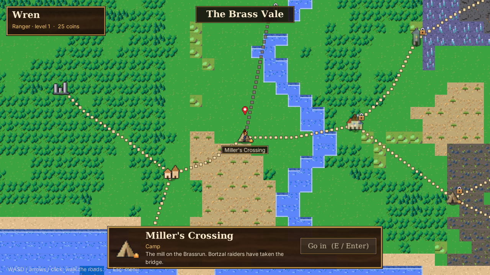
  
</p>

## Contents

- [The game at a glance](#the-game-at-a-glance)
- [Quick start](#quick-start) and [sharing the game](#sharing-the-game)
- [Playing](#playing): the menu, a playthrough, how to play, controls, settings
- [Moving about](#moving-about)
- [Fighting](#fighting)
- [Foes](#foes)
- [Classes and cards](#classes-and-cards)
- [What she carries](#what-she-carries): the inventory, purse and pouch, loot, the wardrobe
- [People, their days, and missions](#people-their-days-and-missions)
- [Shops, crafting and the land's bounty](#shops-crafting-and-the-lands-bounty)
- [The world](#the-world): biomes, water, day and night, weather, life, buildings, the Brass Vale
- [The horde](#the-horde)
- [Sound and music](#sound-and-music)
- [Colours](#colours)
- [Creative Mode](#creative-mode)
- [The art](#the-art): the sprite stack and where it comes from
- [Under the hood](#under-the-hood): rendering, loading, options, layout, tests

---

## The game at a glance

- **A playthrough**: make your character - her people, body, height, face,
  hair and clothes, and one of **nine classes** - then walk the map of **the
  Brass Vale**, eleven places to clear, from the village of Oakhollow to the
  Crystal Hollow. The game saves itself; three slots.
- **Fighting with dice**: every blow rolls D20s over her head in the colour of
  the weapon's rarity - **eight weapons**, each with its own stance and moves,
  heavy and spin attacks, jump attacks, blocks, parries, a dash and a combat
  roll, a lock-on, sneak attacks, ammunition that wears out, upgrade tiers,
  and weapons of your own made in the Forge.
- **Foes that think**: Bortzal, Drurineans, Khorigale, bandits, the Risen,
  the Vérnees serpents from the sky, boar and buffalo. They see only what is
  in their sight, find their way round walls and cliffs, and search where
  they last saw you.
- **A deck of cards** for each class - 200 cards from Common to Mythic - a
  perk tree, levels and experience.
- **People with lives**: they talk, give quests, keep shops, work at their
  posts by day and go home at night and out of storms. Follow up to four
  missions at once.
- **A living moon**: nine biomes, water to wade, swim and dive in, a day that
  turns under a gas giant, rain, snow, fog, sandstorms and thunder, 31 animals
  to watch, hunt or ride, critters, foraging, fishing, crafting and brewing.
- **Towns and houses to walk into**: 3D pixel-art buildings, every one
  furnished inside, recoloured part by part.
- **The horde**: a survival mode - the Risen in rounds, points, weapon boards,
  barricades nailed up board by board, the mystery box.
- **Creative Mode**: the level editor the game is built in - land, water,
  biomes, sky, weather, buildings and their insides, people and their days,
  shops, quests, foes, animals - plus the Forge, the map editor and the horde
  editor.
- **Polish**: one settings menu over every screen (F10), full controller
  support with a focus that moves between every button, a pointer that changes
  with what it is over, a 19-chapter How to play and first-time tips, colour
  grading down to two colours, a sound for everything (and any of them
  swapped for your own), medieval covers for music, 120 frames a second.

## Quick start

Needs **JDK 21** and a graphics driver with **OpenGL 3.3** (anything from the
last decade). Gradle comes with the repository.

**IntelliJ IDEA:** open the folder, let it import the Gradle project, and pick
**Run Game (GPU)** from the run-configuration dropdown. **Build Game to Share
(zip)** makes the copy to send to friends; **Tests** runs the tests.

```bash
./gradlew runGpu        # the game, on the discrete GPU (what the IntelliJ profile runs)
./gradlew run           # the same, letting the OS pick the GPU
./gradlew test          # the unit tests - no GPU needed
./gradlew gameJar       # build/libs/larsons-game.jar (LWJGL and its natives for Windows, macOS, Linux)
./gradlew shareZip      # build/distributions/Larsons-Game.zip: the game to send to friends
./gradlew makeBrassVale # writes the Brass Vale's eleven levels again from tools/BrassVale.java
```

## Sharing the game

`./gradlew shareZip` (or **Build Game to Share (zip)** in IntelliJ) makes
`build/distributions/Larsons-Game.zip`, about 4.3 GB - one folder,
`Larsons-Game/`, for people who never open a terminal. All they need is **Java
21** or newer (free: [Temurin](https://adoptium.net/temurin/releases/?version=21)).
Upload it to Google Drive, OneDrive or Dropbox and send the link.
`./gradlew shareZip -x spritePack` keeps the last sprite pack when only the
code changed.

| In `Larsons-Game/` | |
|---|---|
| `Play on Windows.bat`, `Play on Mac.command`, `Play on Linux.sh` | double-click to play: each finds Java 21 or newer (or says how to get it), starts the game, and if it stops with an error says which log to send |
| `HOW TO PLAY.txt` | installing Java, getting past the operating system's warnings, the controls, and what to send as feedback |
| `larsons-game.jar` | the game and LWJGL's natives for Windows, macOS and Linux, x64 and ARM64 |
| `assets/` | the assets, with the two million sprite PNGs in one `sprites.pack` (in 1 GB parts the game joins the first time it starts), read in place |

The jar sets itself up (`core/Launcher`): started by a double-click it
relaunches itself with what `runGpu` gives it - a heap of 60 % of the machine,
ZGC, macOS's first thread, 4x MSAA - and writes `logs/latest.log` beside
itself, the file to ask for with a bug report.

---

## Playing

### The main menu

<p align="center">
  
  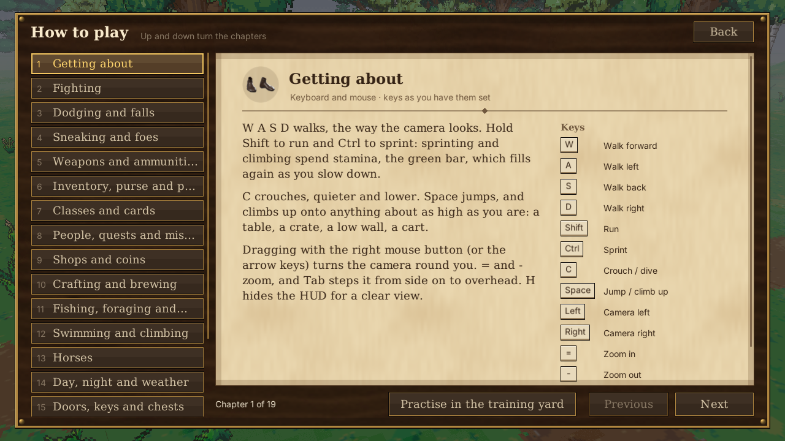
</p>

The main menu is tabs - **Play**, **Horde**, **Cutscene**, and **Dev** (shown
once **1 0 2 5** is typed on the menu; typed again, it hides) - over your own
character in the meadow, with "Dream On" playing for lute, harp and recorder.
**Play** has *Continue*, *New Game*, *Load Game*, **How to play**, *Demo* (the
training yard: dummies, every weapon, a chest, the highlands), *Settings* and
*Quit*. **Settings** sits at the top right of every screen.

### A playthrough

<p align="center">
  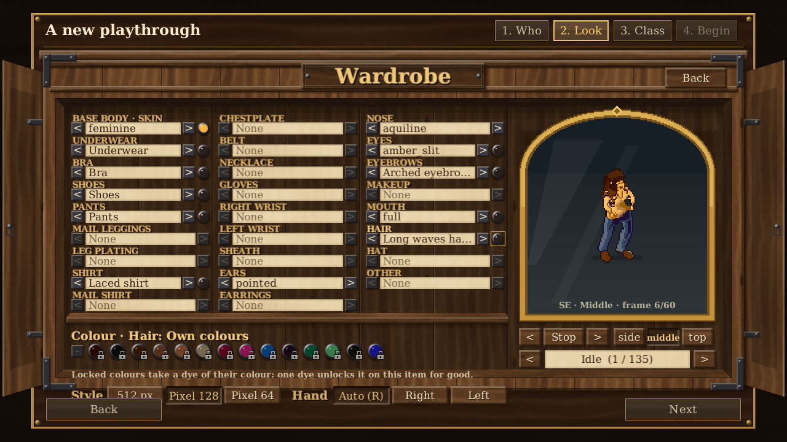
  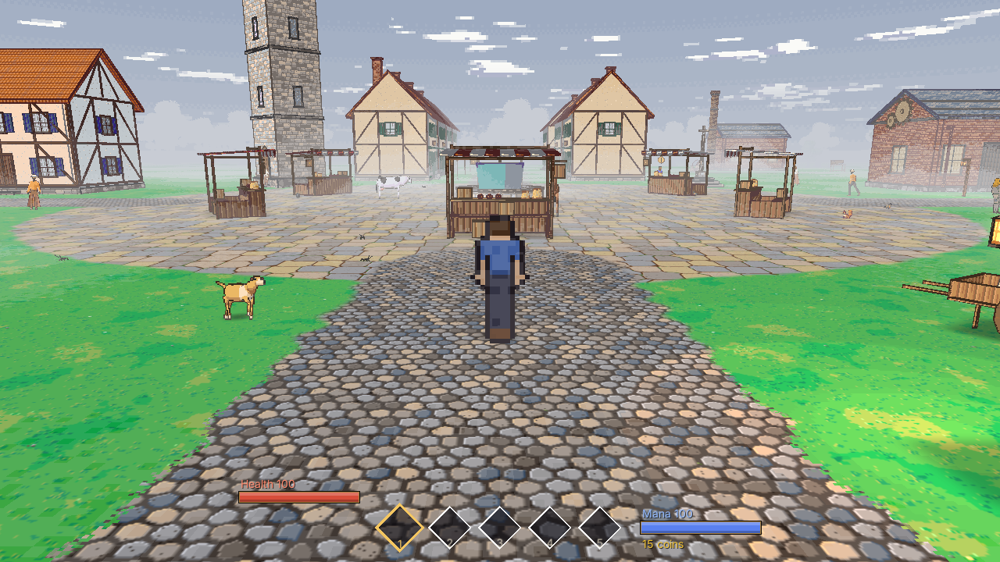
</p>

- **The character creator** (`scene/CreatorScene`): *Who* - her name, her
  people (Human, Drurinean, Half Drurinean or Khorigale), her body, skin and
  height (0.7 to 1.3 of the usual) - *Look* (face, hair, the clothes she
  sets out in), *Class* (the nine, each with its deck and first weapon) and
  *Begin*.
- **The map** (`scene/OverworldScene`) is walked like a platform game's: the
  move keys or the stick take the road that sets off that way, a click walks
  her to a place, **Use**, **Jump** or **Enter** goes in. The roads on from a
  place open once it is **cleared** - by reaching it, by its way out, by
  felling its foes or finishing its quest, as the map says.
- **Saving** is automatic (`save/SaveGame`): her place on the map when she
  arrives somewhere, and all of her - what she carries, her purse and pouch,
  class, cards, level, missions, the doors opened and the chests emptied -
  when she comes back from a level. Three slots, `config/saves/`.

### How to play, and tips

**How to play** (Play tab, and the pause menu) explains every mechanic in 19
chapters - getting about, fighting, dodging, sneaking, ammunition, the
inventory, cards, people and missions, shops, crafting, fishing and hunting,
swimming and climbing, horses, day and weather, doors and keys, the map and
saving, the horde, Creative Mode, settings and controls - each page with the
keys it talks about drawn as they are bound *now*, on the keyboard or the
controller, whichever was touched last. Up and down (or LB and RB) turn the
chapters; *Practise in the training yard* goes to the demo.

In the game, **tips** come up once each the first time something happens -
her first steps, a foe near, someone to talk to, a chest, deep water,
nightfall, a storm, being hidden, a new mission, running out of ammunition
(`scene/Tips`). Settings → Game turns them off, or shows them all again.

<p align="center">
  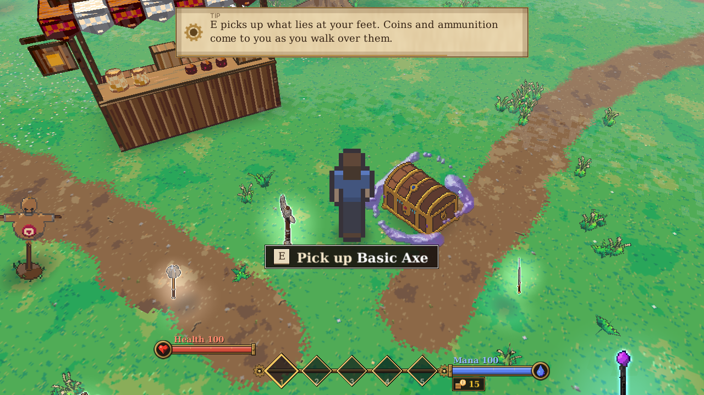
</p>

### Controls

Every key and button can be changed in **Settings → Controls**
(`config/controls.json`), two keys and two gamepad inputs each. An Xbox-style
controller works everywhere, and the prompts on screen follow whichever was
touched last.

| | Keyboard and mouse | Controller |
|---|---|---|
| walk / run / sprint | **W A S D** / hold **Shift** / hold **Ctrl** | left stick / - / **L3** |
| crouch, dive | **C** | d-pad down |
| jump, climb up, come up | **Space** | **A** |
| dash (tap) / combat roll (hold) | **Left Alt** or **Z** | **B** |
| attack (bow: hold to draw) | **left click** or **F** | **RB** |
| heavy attack / spin attack | **X** / **R** | **RT** / **Y** |
| block (held) / parry / shield bash | **B** / **Q** / **V** | **LB** / **LT** / - |
| lock on / next target | **L** / **K** | **R3** / - |
| use, pick up, talk, open, go in, ride | **E** | **X** |
| drop what she holds | **G** | - |
| hotbar | **1 – 5**, the wheel | d-pad left and right |
| inventory / cards / missions | **I** / **J** / **U** | **View** / d-pad up / the inventory's *Missions* |
| camera: turn / zoom / height | right-drag or arrows / **+ −** or the wheel while turning / **Tab** | right stick / - / - |
| time-lapse (held) | **N** | - |
| laugh, cry, surprise, anger | **F1 – F4** | - |
| hide the HUD | **H** | - |
| pause | **Esc** | **Menu** |
| settings, anywhere / full screen | **F10** / **F11** (or Alt+Enter) | - |
| screenshot / performance overlay | **F12** / **F8** | - |

**In menus** a controller moves a focus ring between every button, slider,
choice and text field with the d-pad or the left stick; **A** presses, **B**
goes back, **LB** / **RB** change tabs, the right stick and the triggers
scroll, a focused slider turns with left and right, and text is typed on an
on-screen keyboard. Where a screen wants a pointer - the map, the editor's
view - the left stick moves one (**L3** switches it by hand).

A few more for looking at the art: **[ ]** play each animation in place,
**Backspace** stops, **, .** turn her, **T** turntable, **O** the automatic
camera height, **P** hide the scenery, **F7** the sheets on screen, **F9**
the first version of the weapon moves.

### Settings

<p align="center">
  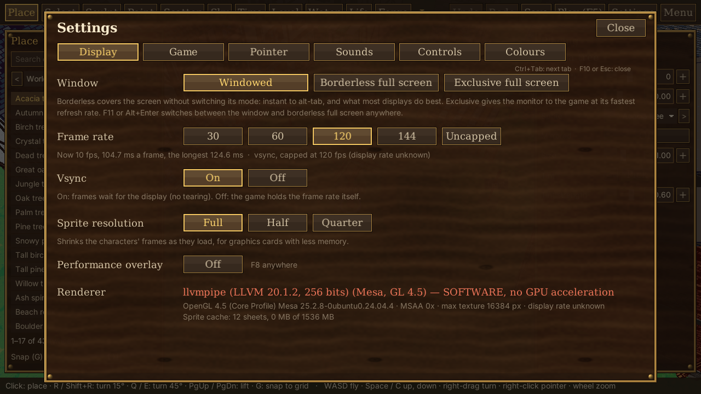
</p>

One settings menu (`scene/SettingsMenu`) opens over **every** screen - the
menu, the game, the map, the character creator, the editors - with **F10**
or the **Settings** button, and saves as it changes (`config/settings.json`):

- **Display**: windowed, borderless full screen or exclusive full screen (at
  the monitor's fastest refresh), the frame rate (30, 60, 120, 144 or
  uncapped), vsync, sprite resolution, the performance overlay, and what the
  renderer is.
- **Game**: the HUD and the missions on it, tutorial tips, picking up by
  walking over (and how near), the camera's height, walls indoors and out,
  scenery, animations.
- **Pointer**: her class's pointer, any class's, a picture of your own or the
  system's, and whether it changes with what it is over - a hand over
  buttons, a speech mark over someone to talk to, a sword over a foe, a key
  over a lock, a coin over a shop, a beam over loot.
- **Sounds**, **Controls** and **Colours**: below.

**F11** (or Alt+Enter) switches between the window and full screen anywhere,
and the choice is kept for the next start.

---

## Moving about

- **Walking, running, sprinting** - stamina (the yellow bar) goes on sprinting,
  climbing and swimming fast, and comes back as she slows. **Crouched** she is
  low and quiet. Ground steeper than she can walk up stops her; rock is rock.
- **Jumping and climbing up**: **Space** by a table, a bench, a crate, a low
  wall - anything up to about her height - and she climbs up onto it; she
  stands on furniture up to 2 m tall.
- **Falls** of more than 3 m hurt, more for every metre. The dodge key in the
  air lands her in a roll, unhurt. Water breaks a fall.
- **Vines** on a cliff are climbed (forward up, back down, sideways along);
  at the top she steps up over the lip, and walking off the top of the vines
  she turns and climbs down.
- **Swimming**: in water deeper than she stands. **C** dives and **Space**
  comes up; under the water she swims where the camera looks, the view tinted
  and muffled, a breath bar going, and she drowns when it runs out.
- **Riding**: with a saddle, **E** by a horse saddles it and **E** again rides
  it - a walk, a canter (Shift) and a gallop (Ctrl), turning no faster than a
  horse can. A saddled horse waits where she left it.

<p align="center">
  
  
  
</p>

## Fighting

<p align="center">
  
  
</p>

**Eight weapons**, each its own stance - idle, walk, run, jump, crouch and its
moves: the **sword** (with a shield, or alone), the **battle axe**, the
**longbow**, the **crossbow**, the **crystal staff**, the **wand**, the
**mace** and the **dagger**. What is in the selected hotbar slot is in her
hands; an empty slot is her bare hands. A left-handed character fights
left-handed.

- **The dice.** Every blow rolls D20s over her head, in the colour of the
  weapon's rarity - **one for Common up to six for Mythic** - and their total
  is the damage, floating up off what was struck. A **heavy attack** (X) rolls
  a die more, once every 10 seconds; the **spin** strikes all round her; a
  **jump attack** - attacking in the air - comes down on everything round her
  with a die more.
- **Bows, crossbows, wands and staffs** shoot: arrows and bolts arc onto what
  she faces, spells fly straight (10 mana each; her **mana** refills). At
  what flies, or what is well above her, she **aims up**; from **the high
  ground** (2.5 m or more above) a shot rolls a die more.
- **Defending**: hold **B** to block (the shield up, or the weapon across),
  **Q** parries a blow just as it lands, **V** bashes with the shield.
- **Dodging**: a tap of the dodge key **dashes** 3.5 m; held, it becomes a
  **combat roll** of 4.7 m in which nothing can hurt her - she rolls through
  her foes.
- **The lock-on** (**L**) brackets the foe nearest the middle of the view:
  the camera keeps it in sight, swings turn to it, shots lead it. **K**: the
  next one.
- **Sneaking**: crouched, still, in tall grass, at night, in fog, rain or snow
  or under the water she is harder to see. **Hidden** (the eye over the
  stamina bar shut), her blows are **sneak attacks**: twice the damage.
- **Rare borders**, one weapon in a hundred: **Venom** (half the damage again
  as poison), **Mystic** (×2.5 damage for twice the mana), **Bonded** (+10 %
  for every living thing it has struck in five minutes).
- **Ammunition**: every weapon wears something out - whetstones for the sword
  and dagger, iron wedges for the axe, studs for the mace, arrow and bolt
  bundles, small crystals for the wand, large ones for the staff - one every
  dozen blows or so. Without it a blade strikes dull (half), and a bow, a
  crossbow, a wand or a staff will not shoot. It lives in her **pouch**
  ([below](#the-inventory-purse-and-pouch)).
- **Tiers and upgrades**: the weapons come in tiers - the sword Basic,
  Sharper, Crystal, Perfect, Mythic; the staff Basic, Magic, Honed, Perfect,
  Mythic; and so on (`world/Tier`) - each its own look, drawn by recolouring
  the same sprites. A forged weapon's tiers (2 to 10) are upgraded with
  **upgrade ingots**: right-click it in the inventory.
- **Forged weapons** ([the Forge](#the-forge)): any of the eight with its own
  name, rarity, colours part by part, dice - how many of a **d4, d6, d8, d10,
  d%, d12 or d20**, and up to four more groups that **add, subtract,
  multiply, divide or scale** the total - and any of the three borders.

Felling a training dummy is practice: the demo's three straw dummies, two
**flying dummies** that dive at her, and dummies on the highlands to shoot
down at. Her **health** comes back five seconds after she was last hurt; at
nothing, she is knocked out and back at the start.

<p align="center">
  
  
</p>

## Foes

<p align="center">
  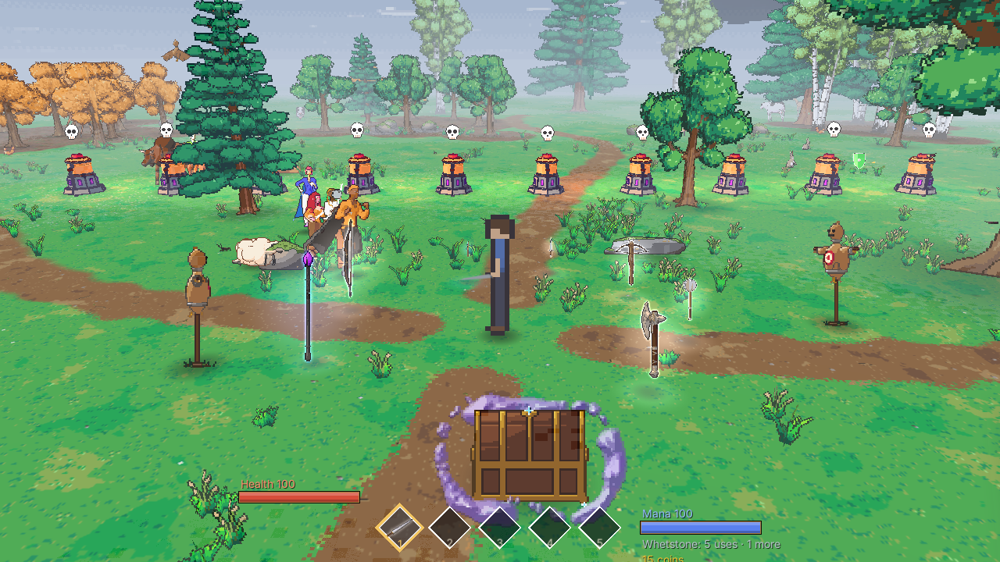
  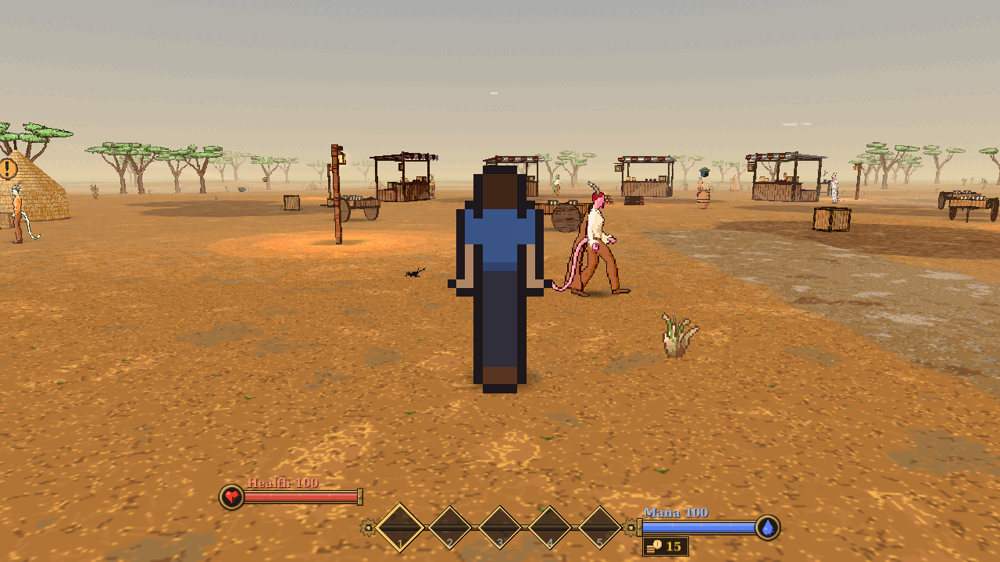
</p>

**The peoples** (`actor/People`, `actor/Looks`): Humans, **Drurineans** (tall,
long-eared), **Half Drurineans**, **Khorigale** (horned and long-tailed),
**Bortzal** (goblin yellow or ashy purple, half a person's height to half as
tall again) and **the Risen**. A person's look - skin, hair, face and clothes
in their people's way of dressing - comes from a seed, the same every time.

**Foes** (`actor/Breed`, `actor/Folks`): Bortzal, Drurineans with wands and
staffs, Half Drurineans with crossbows, Khorigale, bandits; six kinds of
Risen - walker, runner, brute, crawler, ghoul and the Risen Bortzal - on
sprites of their own, fighting with their hands; the **Vérnees** serpents
that come through **sky portals**; wild **boar** and **buffalo** that charge.
They close in, strike, loose arrows and spells, guard and dodge.

**How they find her** (`actor/Paths`):

- **Sight**: a foe sees her only along a clear line from its eyes to hers -
  not through a hill, a wall or a house - within its kind's reach, and less
  far when she is [hidden](#fighting). Losing her, it goes to where it last
  saw her, searches about, then gives up and goes back.
- **The way round**: it walks round what is in the way - a house, along a wall
  to its gap, round a lake - by a search over half-metre cells, pulled
  straight wherever the line is clear, so it walks like someone who knows the
  way. Crowds spread out rather than piling up behind a wall.
- **Where a foot can go**: no steeper than she could walk up, never up a cliff
  or a wall, not into deep water. The high ground is hers to take.

In a level, foes are placed in Creative Mode (**Fight**): one foe, a band, a
**summoning station** that calls a band when used, or a **sky portal**, each
with its breed, size (0.5 to 1.5), weapon, name and health.

## Classes and cards

<p align="center">
  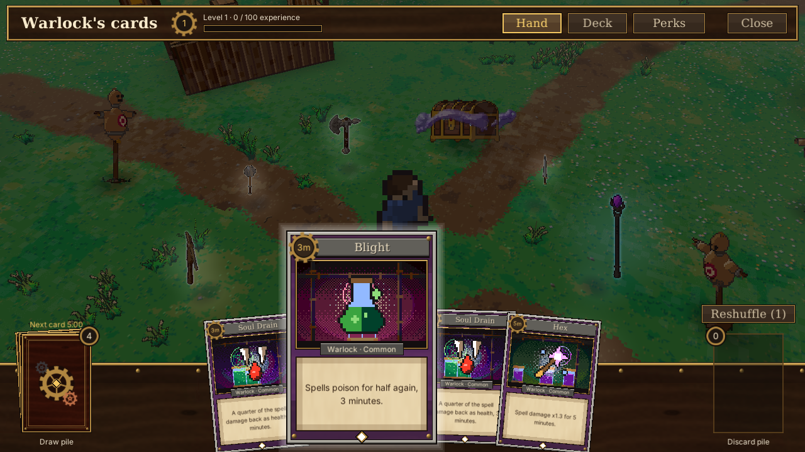
  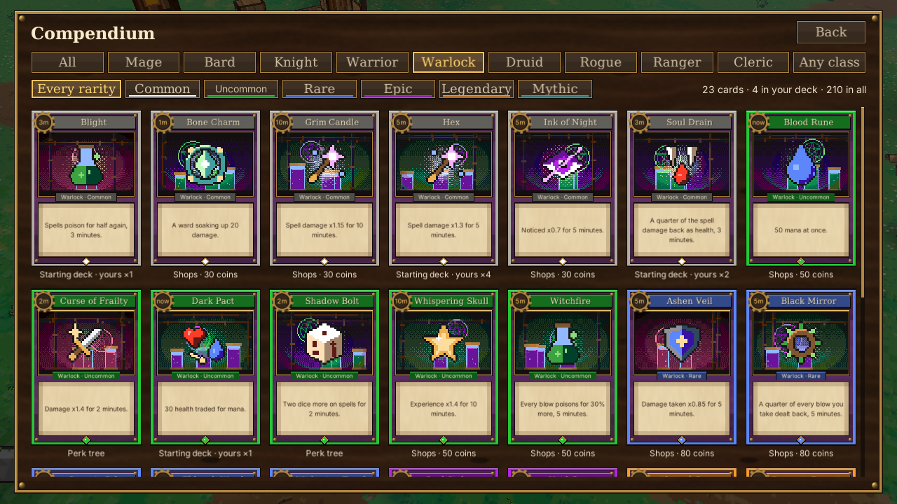
</p>

She is one of **nine classes** - **Mage, Bard, Knight, Warrior, Warlock,
Druid, Rogue, Ranger** or **Cleric** (`assets/cards/cards.json`) - each with
a starting deck of 8 cards and its own mouse pointer. **J** lays out the
**card table**: the game stands still, her hand fanned along the bottom; click
a card or drag it up off the board to play it. She starts with four in hand
and draws one more every five minutes; a **reshuffle scroll** shuffles her
discards back in.

**200 cards**, Common to Mythic, each with its rarity in its frame and a
background of its class: more damage on which blows, cheaper spells, faster
stamina, armour, thorns, lifesteal, poison, more coins or experience, a cloak
to hide in, and things at once - health, mana, a card drawn, coins. What her
cards are doing stands down the left of the screen with the time left on each.

**Experience** comes from felling foes and dummies, hunting, chests and
missions; each level brings a **perk point** for the class's **perk tree**
(four rows, on the card table). Shops sell more cards. **Pause → Compendium**
shows every card there is, by class and rarity, and where each is had;
**Pause → Class** changes class.

## What she carries

### The inventory, purse and pouch

<p align="center">
  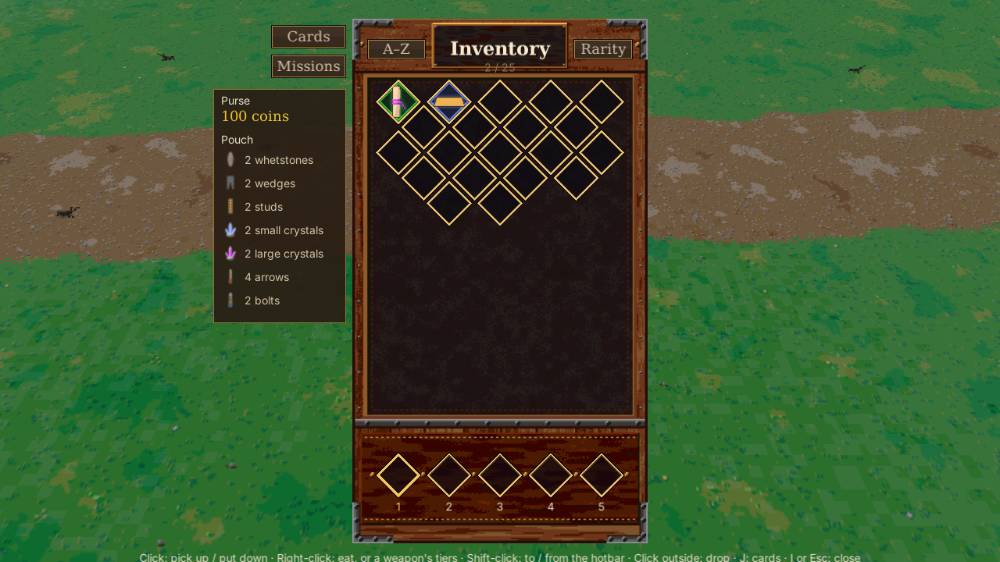
  
</p>

**I** opens the **inventory** (`world/Inventory`): 25 slots as diamonds in a
lattice on oak and leather, the **hotbar's** five along the bottom. Click to
take up and put down, right-click to move to or from the hotbar (or to see a
weapon's tiers), click outside to drop; **A–Z** and **Rarity** sort it.
Satchels, backpacks and explorer's packs add slots for good. Pickings, meat
and makings stack.

**Coins and ammunition never take a slot.** Coins go in her **purse**, and
whetstones, wedges, studs, crystals, arrows and bolts in her **pouch** - both
shown beside the inventory - however full the slots are. She takes them up
just by **walking over them** (Settings → Game: on or off, and how near);
everything else is picked up with **E**. Crafting and the weapons draw on the
pouch; an old save's ammunition in a slot is moved into it.

### Loot, chests and rarity

<p align="center">
  
  
</p>

Everything has a **rarity** - Common (white), Uncommon (green), Rare (blue),
Epic (purple), Legendary (orange), Mythic (cyan) - shown in its glow, its
slot, its name and its beam. A **loot chest** throws out 3 to 7 items, one
Rare or better, each landing in a beam of its rarity's colour - **once**:
emptied, it stays empty (a playthrough remembers it). **Barrels, crates, pots
and storage chests** hold things to take and put in (**E**), and shatter into
pieces when struck, spilling what they held. Items turn in the air over their
shadows, drawn from 128-pixel sprites in their tier's colours.

### The wardrobe

<p align="center">
  
</p>

What she wears is **items** - clothes, armour (chainmail, iron and steel),
jewellery, hair styles, makeup, dyes - found in chests and shops and put on in
**Pause → Wardrobe**, an oak armoire with her in its mirror, turning through
every view and state. **Dyes** unlock a colour on an item for good (fourteen,
from royal blue to green ombre); armour hides what it covers. Two bodies,
feminine and masculine, wear every item; three drawing styles - 512-pixel
renders, 128- or 64-pixel pixel art.

## People, their days, and missions

<p align="center">
  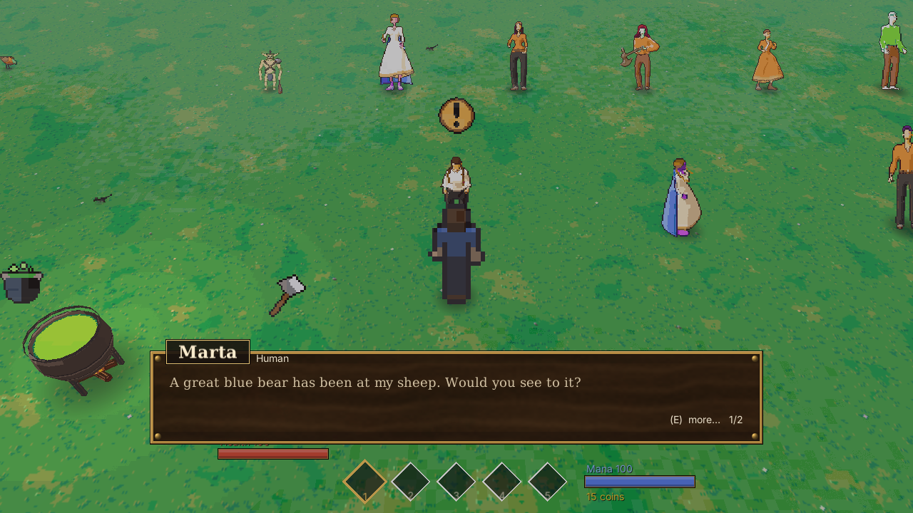
  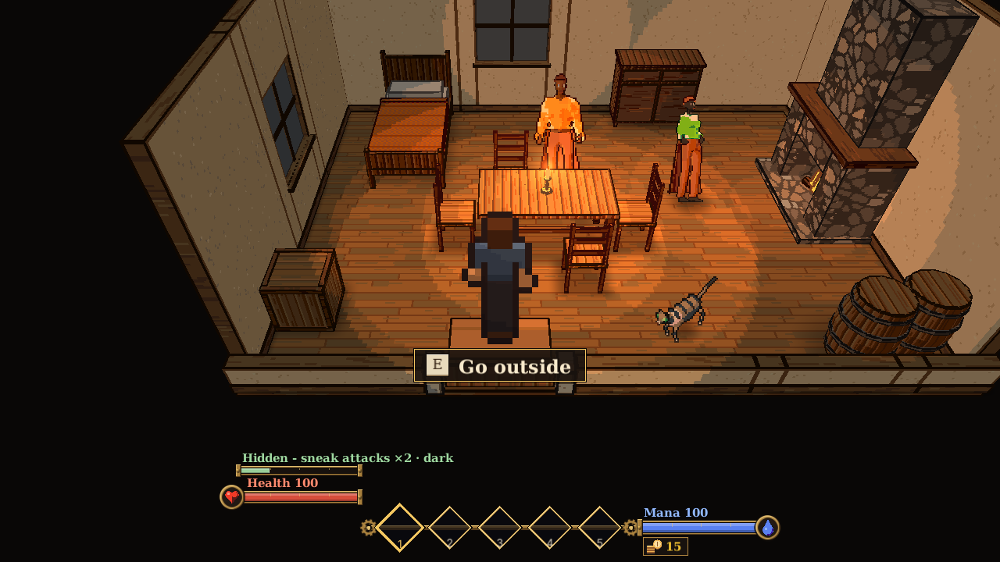
</p>

**Talking**: **E** by someone. They greet her, and she chooses what to ask
about; someone with a mark over their head has work for her. Shopkeepers
sell; some buy.

**Their days** (`actor/Schedule`): everyone keeps a day, hour by hour - each
part of it *what* (stand, work, kneel and tend, keep watch, stroll, walk to
and fro, chat, go inside, sleep) and *where* (at their post, at home, at a
named spot, at a building). By default they keep to their posts by day,
stroll at noon, and **go home at night** - walking to their own door and in.
**In a storm** they go indoors and come out when it passes. In the morning
they come out of their doors and walk back to their posts. Go into a house at
night and the people who live there are inside, to talk to. Their homes are
picked in the editor, or the nearest house with a door is theirs.

**Missions** (`story/Quest`, `story/Quests`): quests are objects of a level -
who gives one, what to do, and what it pays (items, coins, experience).

| To do | Done when |
|---|---|
| **Fell** | so many of a kind - or someone by name - are felled, anywhere or within a ring |
| **Clear** | no foe is left in its ring (or the level) |
| **Talk** | she has talked to the one it names |
| **Bring** | she has so many of an item to hand over |
| **Reach** | she stands inside its ring |

A quest with an **id** is one quest wherever it is told (given in one town,
done in another), and one can wait for another. **U**, or *Missions* in the
inventory, opens the **Missions** page: what each asks, where, what it pays,
*Under way* and *Done*. She **follows up to four at once** - those are listed
at the top right of the screen and their places ringed in the world - and
chooses which with *Follow*.

<p align="center">
  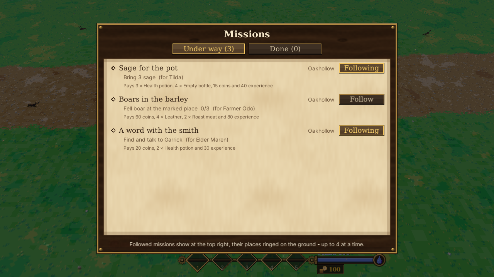
</p>

## Shops, crafting and the land's bounty

<p align="center">
  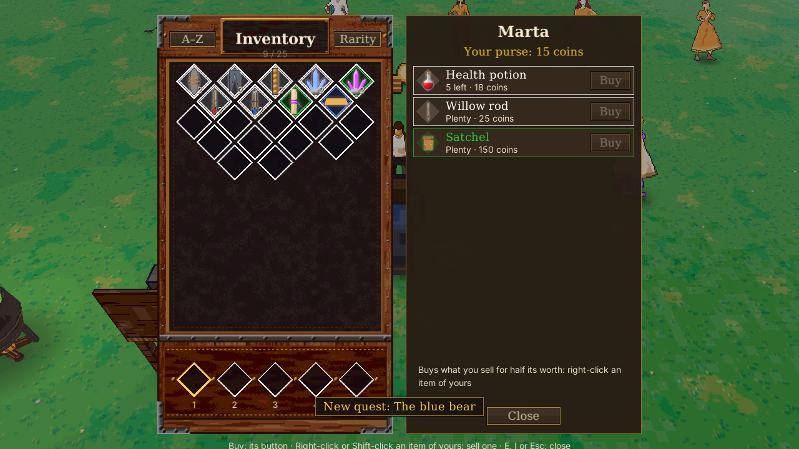
  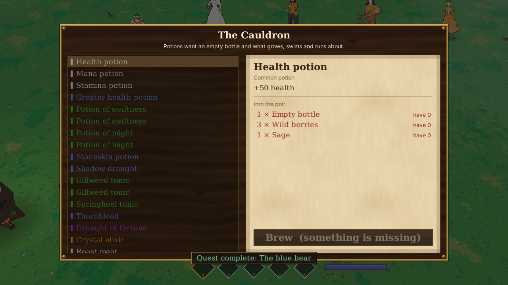
</p>

- **Shops**: a market stall, a shop counter or a shopkeeper sells what its
  stock says - any item in any tier, rarity or colour, how many (or without
  end) and at what price - beside her inventory; a shop that buys pays half
  what a thing is worth.
- **Goods** (`world/Goods`): **potions** (health, mana, stamina, swiftness,
  might, stoneskin, shadow, gills, springheel, fortune, thornblood, the crystal
  elixir) and **scrolls** (stronger, never made), **keys** for locked doors and
  gates (rusty to crystal, and the skeleton key), **spawner eggs**, **fishing
  rods**, **packs**, meals, and the makings - bottles, parchment, ink, twine,
  gears, iron bars, crystal dust, leather, cloth.
- **Crafting and brewing** (`world/Recipes`): at a **workbench**, the makings,
  rods, packs, keys, ammunition and trinkets; at a **cauldron**, potions and
  meals. Each recipe shows what it takes and what she has.
- **Fishing** (`scene/Fishing`): cast, strike when the float dips, then keep
  the fish inside the catch on the gauge until it is in. A better rod, a
  longer moment and rarer fish.
- **Foraging**: bushes of berries, sage, sunfruit and the crystal bloom, in
  their biomes, picked bare and growing back.
- **Hunting**: game leaves meat, hides, pelts, wool, feathers and antlers.
- **Locked doors and gates** say what opens them: a key (used up or kept) or
  a price.

## The world

### Biomes and water

<p align="center">
  
  
</p>

**Nine biomes**, each with its ground, plants, trees, rocks, water, weather
and sounds by day and by night: **plains**, **marsh**, **mountains**,
**jungle**, **savannah**, **ocean shore**, **river**, **waste** and
**crystal** (glowing at night). **Water** is ponds and lakes lying level,
streams following the ground down, swamp water with lily pads, crystal water,
and the sea; she wades the shallows and swims the deep. Tall grass bends
aside as she goes through it; her footsteps sound of what she walks on.

### Day, night and weather

<p align="center">
  
  
</p>

The world is a **moon** of a gas giant that hangs, banded and huge, in the
same place in the sky; the sun goes round it, so it is a thin crescent by day
and **full at midnight**, lighting the night. The light goes gold, rose and
blue through the day; clouds, stars, an aurora, mist and light rays come and
go; lanterns, candles, fires and crystals light the dark. A day is 24 minutes
(**N** to time-lapse). **Weather** - rain, thunderstorms with lightning,
snow, fog, wind, sandstorms - comes and goes by biome, or is set for a level.
A level can be **inside** (a hall, a dungeon) or a **cave**, with no sky.

### Life

<p align="center">
  
  
</p>

**Critters** - fireflies, crickets, frogs, dragonflies - come and go round
her by the place and the hour. **Thirty-one animals** - horses, cows, bears,
sheep, pigs, dogs, foxes, cats, rabbits, squirrels, deer, ducks, geese,
swans, butterflies, bees, iguanas and fourteen birds from robins to peacocks
- each drawn from 24 views, with a **nature**: tame, calm, skittish,
friendly, defensive or hostile. They live where a level places them, or as
many as its **Life** page asks for: none come by themselves.

### Buildings

<p align="center">
  
  
</p>

The buildings are **3D models in pixel art** (built in code by 3D-Modeling's
`buildings/buildings.py`): cottages, town houses, a log cabin, a windmill and
a watermill, a castle's keep, walls, gatehouse, towers, turret and spire; the
town's market stalls, narrow town houses, shop house, steam workshop, clock
tower and foundry; stables, wells, fountains, statues. **Any part in any of
the 128 colours and any of 20 patterns** (brick to thatch), as walls are done
in the Sims. They are solid, their windows lit at night, and the walls between
the camera and her drop away so she is never hidden.

**Every door can be gone through.** Inside, each kind comes **furnished** -
beds, tables, hearths, shops, a laboratory's boilers and coils - with stairs
between its floors, lit by its candles and fire. Furniture is 3D too: a
hundred kinds from beds and bathtubs to hay bales and weapon racks.

### The Brass Vale

The game's first lands (`assets/overworld/maps/brass_vale.json`): **Oakhollow**
(home), **Miller's Crossing**, **Brasswick** (the market town), the
**Whispering Wood**, **Fisher's Rest**, **Copperpit Mine**, the **Drurin
Observatory**, the **Khorigale Camp**, the **Sallow Marsh**, the **Old
Watchtower** and **Crystal Hollow**, with the East Gate leading on. Each is a
level of `assets/levels/`, written by `tools/BrassVale.java`
(`./gradlew makeBrassVale`) and open to change in Creative Mode. The sample
levels beside them - `village`, `town`, `building_lineup`, `biome_tour` -
show what there is.

## The horde

<p align="center">
  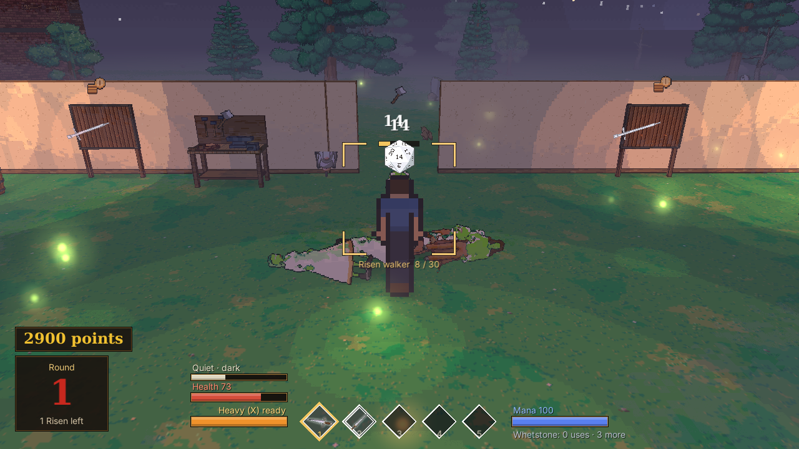
  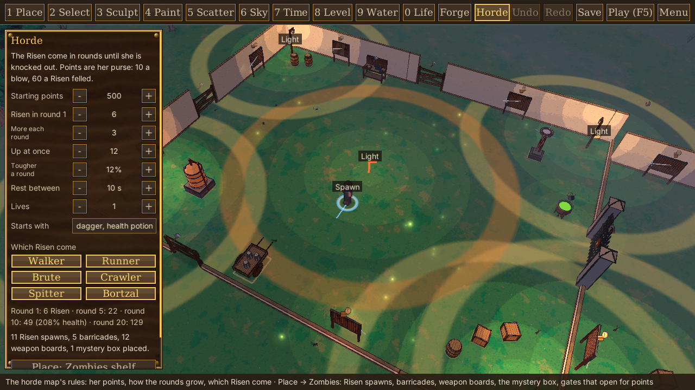
</p>

The **Horde** tab (`scene/HordeGame`): the Risen come in rounds, more and
tougher each, out of their spawns and through the barricades, until she is
down. **Points** - for blows, kills and boards nailed back - buy the weapons
on the **boards** on the walls (each showing what it sells, forged weapons
too), a turn of the **mystery box**, and the **gates** to the rest of the map.
**E** by a barricade nails a board back on, **board by board**, and the Risen
tear them off one at a time. Nobody gets out through the Risen's own
entrances. The felled leave gifts: max ammo, insta-kill, double points,
kaboom, carpenter. Two maps come with it - the **Foundry Yard** and
**Gravewood Clearing** - and the horde editor makes more.

## Sound and music

<p align="center">
  
</p>

A sound for everything that happens - footsteps on each ground, every swing,
shot, spell and die, the creatures, the chests and the loot, the weather, the
biomes by day and night, the menus - through the engine's own pure-Java MP3
decoder and mixer, placed in the world (quieter farther off, panned to its
side). **Settings → Sounds** has a tab for each of nine categories with its
own volume; every sound can be played, **swapped for any MP3 or WAV of
yours** (or a file dropped on its row), muted or reset. The sounds in
`assets/sounds/` are original placeholders made in code
(`tools/sounds/make_placeholders.py`); `SOUND_KEYS.txt` lists every one to
replace.

**Music**: medieval covers - lute, harp, recorder, fiddle, organ drone, hand
drum - of the songs on the roadmap, not for sale, each a seamless loop
(`assets/sounds/music/`) with its MIDI in [`music/`](music/README.md) for FL
Studio. The main menu plays "Dream On"; each level plays the song its maker
picked, or shuffles them all.

## Colours

<p align="center">
  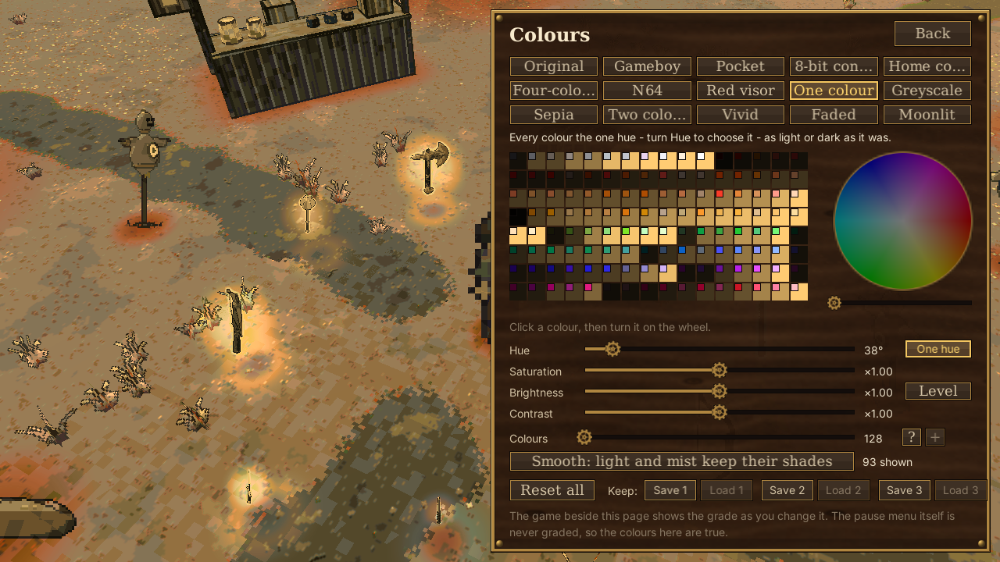
  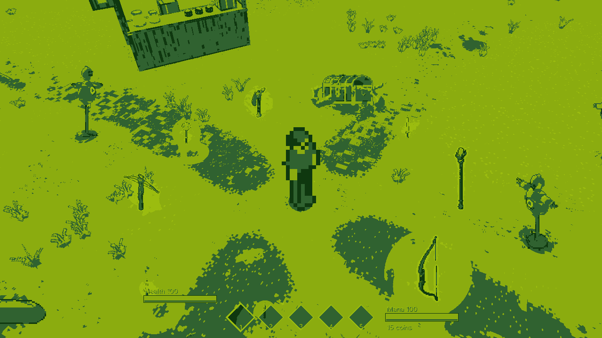
</p>

All the art is drawn in **one palette of 128 colours**
(`assets/sprites/pixel_palette.json`). **Settings → Colours** (`grade/Grading`)
gives any of them another, shifts them all together (hue, saturation,
brightness, contrast), or brings the 128 down to as few as two. Presets:
Original, Gameboy, Pocket, 8-bit console, Home computer, Four-colour PC, N64,
Red visor, One colour, Greyscale, Sepia.

---

## Creative Mode

<p align="center">
  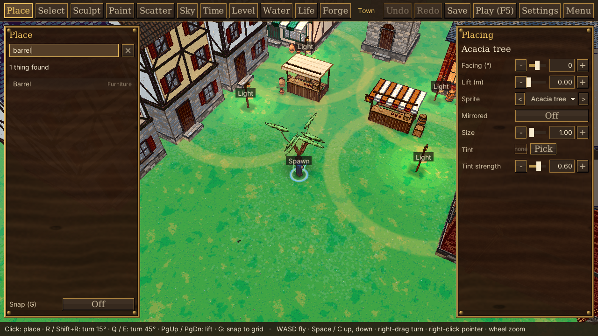
  
</p>

Creative Mode (`editor/CreativeScene`) is the game's level editor - where the
game's places are built. **Dev** tab: *New level*, *Copy the demo*, and every
saved level to **Edit**, **Play**, **Copy** or **Delete**; the map editor and
the horde maps are there too. The editor shows the level as it will be
played, what you are about to place standing under the pointer.

| Tool | |
|---|---|
| **1 Place** | the palette, by category: **World** (scenery, rocks, life), **Build** (buildings, the town, walls and rooms, doors and locks), **Furnish** (furniture, kitchen, decor, plants, farm, clutter, lights), **Story** (people, quests, spots), **Fight** (foes, bands, summoning stations, sky portals, dummies), **Items** (weapons, wearables, goods, chests), **Zombies** (the horde's) and **Other** |
| **2 Select** | click, Shift+click, drag a box; move, turn, delete, duplicate, copy and paste, save as a template |
| **3 Sculpt** | raise, lower, smooth, flatten |
| **4 Paint** | sixteen grounds - and roads of cobbles, flagstones, brick and packed earth - and the **biome** brush |
| **5 Scatter** | plants, trees and rocks: one, a mix, a biome's, or a brush of your own |
| **6 Sky** | the sky's colours, the fog, distant backgrounds round the horizon, open sky, inside or a cave |
| **7 Time** | the hour it starts at, the day's length, the planet, clouds, stars, aurora, mist, light rays, and the weather |
| **8 Level** | name, size (64 m to 2048 m), the walls in the way, the music |
| **9 Water** | ponds, streams, swamp, crystal water, the sea |
| **0 Life** | how many critters and of each animal |
| **Forge** | weapons of your own |

**Ctrl+F searches everything there is to place**, by name, across every
category. **Every number** - size, tint strength, health, how many, facing,
lift - is a **slider with a box to type in**. Sculpt, Paint and Scatter have
**filters** (between slopes, between heights, only on a ground, dry or under
water). Ctrl+Z / Ctrl+Y undo and redo (one step per drag), Ctrl+S saves,
**F5 play-tests** from the spawn (Shift+F5: from the pointer) and **F5** again
comes back.

**People, shops and quests are made by picking, not typing**
(`level/Rows`, `editor/Widgets`):

- **A shop's stock** is a list of rows - the item (a dropdown of everything
  there is), its tier, how many (or without end) and the price (or what it is
  worth) - with *Add something to sell*, and whether it buys.
- **A person** has a name, a people, a look, what they say when greeted,
  **what she can ask about** (a row each: the question, the answer), a stock
  if they sell, **where they live** (the nearest house, none, or a building
  picked) and **their day**: a row for each part of it - from what time, what
  they do, and where.
- **A quest** has its title, **who gives it** (picked from the level's
  people), what to do, **what or whom** (picked: a breed, a person, an item),
  how many, within how far, what they say asking for it, while it is not done
  and when it is, **what it pays** (rows of items with their tiers and
  counts, coins, experience), who it is handed in to, and which quest it
  waits for.

<p align="center">
  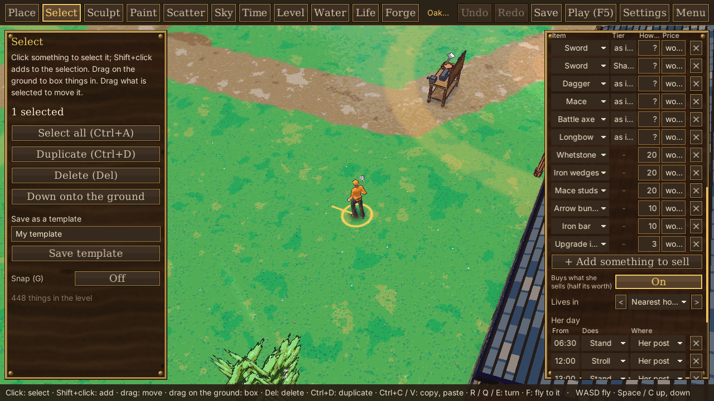
  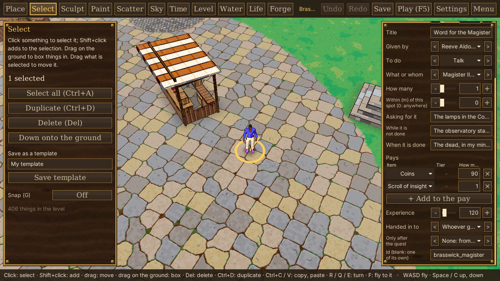
</p>

**Buildings** are dressed part by part (**Look**: any of the 128 colours and
the 20 patterns, copied from one to another), and **Edit inside** opens their
floors - walls, doorways, windows, stairs, furniture, chests, people - to
furnish and play-test from inside.

### The Forge

<p align="center">
  
</p>

The **Forge** makes weapons of your own: a name, which of the eight it is
(its look, stance and moves), its rarity, its colours part by part (a sword's
blade, fittings and handle; the dice), its dice and their operators, its
effects, how long its ammunition lasts, and its upgrade tiers (each a name,
rarity, dice, colours, its price in ingots, or a mystery shown as ???). Saved
in `assets/forge/<name>.json`, placed from **Items → Weapons** and sold in
shops and on horde boards like any weapon (`forged:<id>`).

### The map editor and the horde editor

<p align="center">
  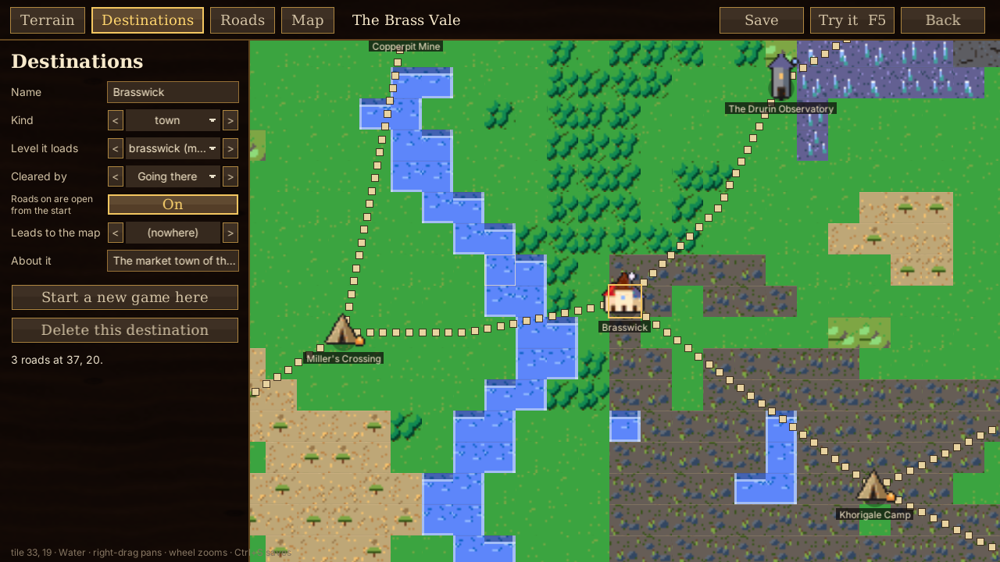
  
</p>

**The map editor** (`editor/OverworldEditor`) paints the overworld's
fourteen terrains, places destinations - a name, an icon, **the level it
loads**, what clears it, whether its roads are open from the start, another
map it leads to - draws the roads between them, and sets where a new game
starts; *Try it* walks the map. **The horde editor** is Creative Mode with a
**Zombies** shelf - Risen spawns (which kind, from which round, behind which
gate), barricades, weapon boards, the mystery box, gates - and the map's
rules: starting points, how the rounds grow, how many at once, lives, her
kit, which Risen come.

### Levels on disk

A level is a folder of `assets/levels/`, meant to be read and to sit in git:

```
assets/levels/<level>/
  level.json    its name, size, sky, time, weather, music, life, and every object (one a line), and the buildings' insides
  height.png    the sculpted ground, 16-bit grey: a height every 0.5 m (value / 256 - 128 m)
  ground.png    the paint, a pixel every 0.25 m (ground2.png, ground3.png for the other grounds)
  water.png     the water, a pixel every 0.5 m: its surface, its kind, the way it flows
```

```json
{"id": 12, "type": "person", "x": -10, "z": 0, "yaw": 180, "name": "Mira",
 "schedule": "06:30=stand@post; 12:00=wander@square; 13:00=work@post; 21:00=sleep@home", "home": "building:7"}
```

Keys and kinds this game does not know are read and written back as they
were. **Every kind of thing** is one registration in `level/ObjectTypes`
(and the people and quests in `level/FolkTypes`): its props are edited in the
right panel, saved, undone and copied with no more work.

---

## The art

### The sprite stack

Characters, creatures and items are **2D sprites pre-rendered in Blender**
from **8 directions × 3 heights** - side (0°), middle (45°) and top (90°),
chosen by the camera's angle - and every character is a **stack of layers**,
one sprite sheet each: body, underwear, bra, shoes, pants, shirt, belt,
necklace, gloves, wrists, sheath, ears, earrings, nose, eyes, eyebrows,
makeup, mouth, hair, hat, cape, and the two hands. Each layer is rendered
with the body as a **holdout**, so the sword is already cut away where the
hand grips it, and the game only stacks them. The full contract is in
[`assets/sprites/README.md`](assets/sprites/README.md):

```
assets/sprites/<layer>/<item>_px128/<state>_<elevation>_<direction>.png
assets/sprites/carry_right/battle_axe_px128/axe_attack_middle_ne.png
assets/sprites/items/<id>/spin_px128/          an item turning, for the world and the inventory
assets/sprites/objects/<object>/               the chests, dummies, critters, animals and the Risen
```

- **131 animation states** per body - walking to riding, every weapon's
  moves, climbing, swimming, emotes - at 30 fps.
- **Palette sheets**: the pixel art is 128- and 64-pixel frames of palette
  indices, coloured on the GPU from a palette row each (`gfx/PaletteAtlas`),
  so any item can be any colour without a new sheet, and **weapon tiers**
  are recolourings of the same sheets (`assets/sprites/tiers.json`).
- **Two bodies** (`assets/sprites/`, `assets/sprites_masculine/`) wear every
  item; right- and left-handed.
- **Loading** is on demand on worker threads within a video-memory budget,
  and a layer change shows only once every layer of it is ready.
- **Close-ups** of the same items play the **cutscenes**
  (`assets/cutscenes/`, `assets/closeups/`), so your own character - in
  whatever she wears - can be in them.

**Importing**: drag sheets, a folder of them, or Blender's numbered frames
onto the game window; the importer guesses the layer and name, stitches
frames into sheets and writes them into `assets/sprites/`, ready to commit.

### Where it comes from

Everything is modelled, rigged, animated and rendered in
[**3D-Modeling**](https://github.com/Larleeloo/3D-Modeling): the two bodies
and every item, the weapons, the creatures (`creatures/`), the Risen, the
items' turning sprites (`items/item_spin_sprites.py`), the scenery
(`scenery/`), the buildings and furniture (`buildings/buildings.py`, written
straight into `assets/buildings/`), the dice and combat effects - all snapped
to the one 128-colour palette.

---

## Under the hood

### Rendering

The whole game draws through **OpenGL 3.3 core** (LWJGL 3.3.3): the ground,
the water, the buildings, every sprite layer and shadow, and the UI, text
included (`gfx/`, an immediate-mode `ui/Ui`). It aims for **120 frames a
second, every frame the same length** (`core/FramePacer`): vsync where it
gives the target, its own pacing elsewhere, a ring buffer for vertices,
uploads spread over frames, and generational ZGC. **F8** shows the
performance overlay in the game and the editors. On a software renderer it
still runs, and says so in red.

### The loading screen

The window opens at once on a screen that shows every step of loading -
graphics, the sprite index (some two million sheets), the world, the sounds,
the menu - with what each found and how long it took, a bar weighted by last
time's timings (`config/boot.json`), and a step that fails held on screen in
red.

### Launch options

| Option | Default | |
|---|---|---|
| `-Dlarsons.start=…` | menu | `demo`, `play:<level>`, `edit:<level>`, `creative`, `newgame`, `mapedit`, `horde:<map>`, `hordeedit:<map>` |
| `-Dlarsons.gpu.msaa=4` | 4 | multisampling (0: off) |
| `-Dlarsons.gpu.vsync=on` | saved | vsync for this run |
| `-Dlarsons.fps=120` | saved | the frame rate for this run (0: uncapped) |
| `-Dlarsons.sprites.scale=1` | 1 | shrink sprite frames as they load |
| `-Dlarsons.sprites.vramMB=1536` | 1536 | the sprites' video-memory budget |
| `-Dlarsons.inventory.slots=25` | 25 | inventory slots, the hotbar's five included |
| `-Dlarsons.perf.log=true` | off | print the performance overlay once a second |
| `-Dlarsons.script=…` | - | a scripted run (below) |

### Project layout

```
src/main/java/com/larsons/game/
  core/       Game (window, loop, overlays), Boot and LoadingScreen, FramePacer, Settings, Launcher, SpritePack, Autopilot
  gfx/        Window, Shader, Texture, Batch, PaletteAtlas, Font, GpuInfo
  input/      Input (keys, mouse, gamepad, the menus' focus), Action, Bind, Bindings, Pad
  ui/         Ui (immediate-mode, with the gamepad's focus and keyboard), Theme, Glyphs, CardArt, MenuList
  scene/      MainMenuScene, DemoScene (a level played), CreatorScene, OverworldScene, HordeGame, PauseMenu,
              SettingsMenu, HowToPlay, Tips, InventoryPanel, Story (talk, missions, workbench, cauldron), CardTable,
              Compendium, Fishing, WardrobePanel, ControlsPanel, ColoursPanel, SoundsPanel
  world/      World, Player, OrbitCamera, Inventory (and its pouch), Item, ItemDef, Goods, Supplies, Ammo, Recipes,
              Shop, Chest, Store, Loot, Rarity, Tier, Border, Stealth, Weather, DayCycle, Sky, Terrain, WaterMap,
              WorldRenderer, ItemRenderer, WaterRenderer
  actor/      People, Looks, Breed, Folk, Folks (foes and people), Paths (ways round, sight), Schedule (a day)
  story/      Quest, Quests
  combat/     Combat, DiceRoll, Move, Strike, Projectile, Dummy, FlyingDummy, CombatHud
  cards/      CardBook, Card, Deck, Hero
  ambient/    Critters, Animals, AnimalKind, Temperament, Life, Hunting
  building/   BuildingCatalog, Building, BuildingProfile, BuildingLook, ModelRenderer, Room, Prefab
  level/      Level, LevelObject, ObjectTypes, FolkTypes, HordeTypes, Rows, LevelWorld, LevelIO, Interiors
  editor/     CreativeScene, OverworldEditor, Widgets, LevelView, Picking, Gizmos, Undo, Scatter
  overworld/  Overworld, MapView
  save/       SaveGame, Saves
  sprite/     SpriteLibrary, LayerStack, Wardrobe, Slot, AnimState, Stance, SpriteView, ObjectSprites, ItemSprites
  audio/      Mp3Decoder, SoundMixer, Sounds, SoundKeys, SoundCategory, WorldSounds, Music, Songs
  cutscene/   Cutscene, Actor, CutsceneStage
  grade/      Grading, Preset
  tools/      BrassVale, Land, PackSprites, SampleSprites
assets/       sprites/, sprites_masculine/, closeups/, buildings/, scenery/, levels/, horde/, overworld/, forge/,
              cards/, combat/, cutscenes/, sounds/, ui/  (each with a README where it has a format)
music/        the songs' MIDI files, for FL Studio
tools/        the scripts that make the placeholder sounds, the music, the UI art and the horde maps
dist/         the shared copy's launchers and HOW TO PLAY.txt
```

### Tests and scripted runs

`./gradlew test` runs the unit tests - none needs a GPU: the views and the
sprite contract, the library and importer, palettes and tiers, the player's
moves, falls, climbing and swimming, combat and the dice, the foes' ways and
sight, the folk's days, the inventory, purse and pouch, loot and chests,
cards, quests and missions, shops and the editor's rows, levels saved and read
back, undo, the buildings and their insides, the weather and the day, the
sounds and the music, saving and the map.

The game also drives itself, for smoke tests and screenshots on a machine
with no screen (`core/Autopilot`):

```bash
xvfb-run ./gradlew run -Dlarsons.start=play:oakhollow \
  -Dlarsons.script="wait 4; time 21:30; wait 1; enter; wait 1; shot inside-at-night.png; quit"
```

Everywhere: `wait`, `scene`, `shot`, `key`, `hold` / `letgo`, `type`,
`click`, `press` / `release`, `move`, `scroll`, `drop`, `quit`. In the game:
`teleport`, `goto`, `time`, `timelapse`, `weather`, `give`, `coins`, `hero`,
`wear`, `colour`, `style`, `stance`, `attack`, `heavy`, `spin`, `parry`,
`block`, `dash`, `roll`, `jump`, `crouch`, `lock`, `pickup`, `chest`,
`store`, `shop`, `door`, `enter`, `outside`, `say` / `endtalk`, `journal`,
`station`, `summon`, `animal`, `health`, `fall`, `climb`, `round` (the
horde's), and more. In the editor: `tool`, `entry`, `place`, `select`,
`selectid`, `set`, `look`, `sculpt`, `paint`, `biome`, `water`, `sky`,
`backdrop`, `life`, `forge`, `save`, `undo`, `playtest`. Their full forms are
in `DemoScene.script` and `CreativeScene.script`.

---

Built on mechanics from
[Larsons-Game-Engine](https://github.com/Larleeloo/Larsons-Game-Engine) - its
JSON reader, its sound system (the MP3 decoder and mixer), its window and
input - made GPU-first for one window.
