# Larson's Game

**An action role-playing game on a moon of oak, brass and old magic.** A 3D
world - hills, rivers, towns, castles and caves under a great banded planet -
where every character, creature and item is **pixel art pre-rendered in
Blender** from eight directions and three heights, and every shirt, hat and
sword is a sprite layer of its own. Medieval, with steam and clockwork coming
in. Built in Java on OpenGL, with a full level editor - **Creative Mode** - in
which the game's real places are made.

<p align="center">
  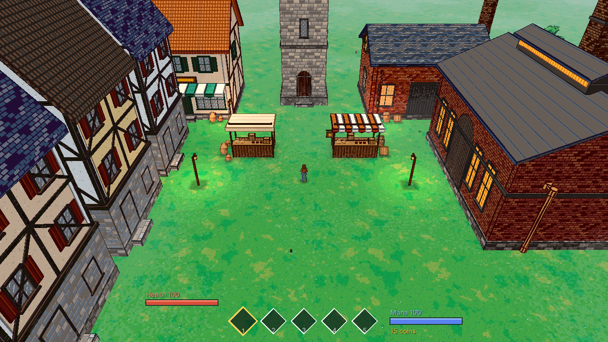
  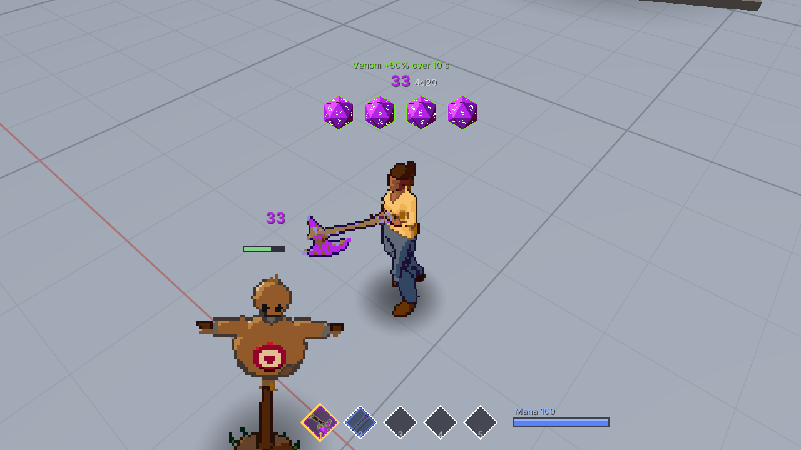
</p>
<p align="center">
  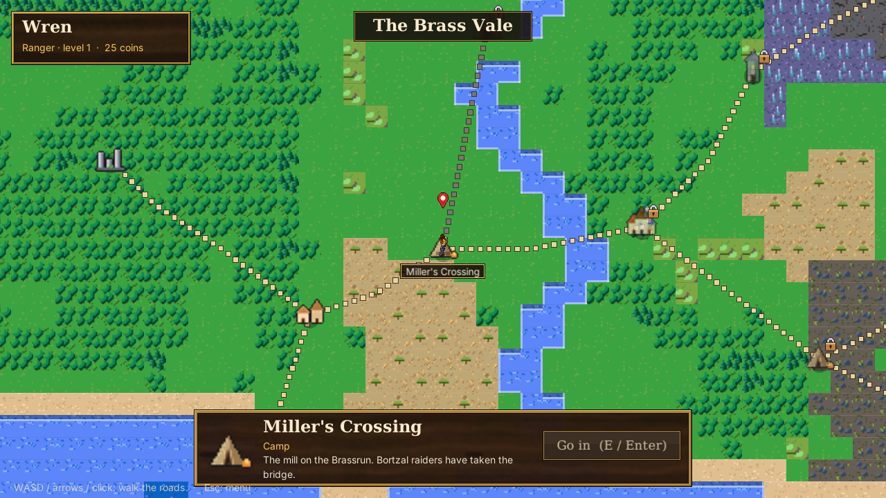
  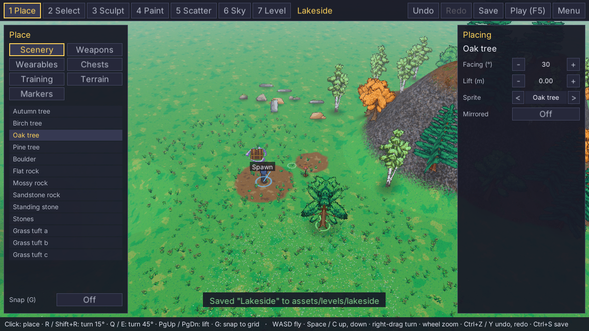
</p>

## Contents

- [The game at a glance](#the-game-at-a-glance)
- [Quick start](#quick-start) and [sharing the game](#sharing-the-game)
- [Playing](#playing): the menu, a playthrough, how to play, controls, settings
- [Moving about](#moving-about)
- [Fighting](#fighting)
- [Foes](#foes)
- [Classes and cards](#classes-and-cards)
- [What she carries](#what-she-carries): the inventory, purse and pouch, loot, the wardrobe
- [People, their days, and missions](#people-their-days-and-missions)
- [Shops, crafting and the land's bounty](#shops-crafting-and-the-lands-bounty)
- [The world](#the-world): biomes, water, day and night, weather, life, buildings, Old London, beyond the edge, the Brass Vale
- [The horde](#the-horde)
- [Sound and music](#sound-and-music)
- [Colours](#colours)
- [Creative Mode](#creative-mode)
- [The art](#the-art): the sprite stack and where it comes from
- [Under the hood](#under-the-hood): rendering, low-end machines (Lite), loading, options, layout, tests

---

## The game at a glance

- **A playthrough**: make your character - her people, body, height, face,
  hair and clothes, and one of **nine classes** - then walk the map of **the
  Brass Vale**, eleven places to clear, from the village of Oakhollow to the
  Crystal Hollow. The game saves itself; three slots.
- **Fighting with dice**: every blow rolls dice over her head - a D4 bare
  handed up to a D12 for a staff or a wand - in the colour of
  the weapon's rarity - **eight weapons**, each with its own stance and moves,
  heavy and spin attacks, jump attacks, blocks, parries, a dash and a combat
  roll, a lock-on, sneak attacks, ammunition that wears out, upgrade tiers,
  weapons of your own made in the Forge - and **armour that rolls dice** to
  block every blow.
- **Foes that think**: Bortzal, Drurineans, Khorigale, bandits, the Risen,
  the Vérnees serpents from the sky, boar and buffalo. They see only what is
  in their sight, find their way round walls and cliffs, and search where
  they last saw you.
- **A deck of cards** for each class - 200 cards from Common to Mythic - a
  perk tree, levels and experience.
- **People with lives**: they talk, give quests, keep shops, work at their
  posts by day and go home at night and out of storms. Follow up to four
  missions at once.
- **A living moon**: nine biomes, water to wade, swim and dive in, a day that
  turns under a gas giant, rain, snow, fog, sandstorms and thunder, 31 animals
  to watch, hunt or ride, critters, foraging, fishing, crafting and brewing.
- **Towns and houses to walk into**: 3D pixel-art buildings, every one
  furnished inside, recoloured part by part.
- **The horde**: a survival mode - the Risen in rounds, points, weapon boards,
  barricades nailed up board by board, the mystery box.
- **Creative Mode**: the level editor the game is built in - land, water,
  biomes, sky, weather, buildings and their insides, people and their days,
  shops, quests, foes, animals - plus the Forge, the map editor and the horde
  editor.
- **Polish**: one settings menu over every screen (F10), full controller
  support with a focus that moves between every button, a pointer that changes
  with what it is over, a 20-chapter How to play and first-time tips, colour
  grading down to two colours, a sound for everything (and any of them
  swapped for your own), medieval covers for music, 120 frames a second.

## Quick start

Needs **JDK 21** and a graphics driver with **OpenGL 3.3** (anything from the
last decade). Gradle comes with the repository.

**IntelliJ IDEA:** open the folder, let it import the Gradle project, and pick
**Run Game (GPU)** from the run-configuration dropdown. **Build Game to Share
(zip)** makes the copy to send to friends; **Tests** runs the tests.

```bash
./gradlew runGpu        # the game, on the discrete GPU (what the IntelliJ profile runs)
./gradlew run           # the same, letting the OS pick the GPU
./gradlew test          # the unit tests - no GPU needed
./gradlew gameJar       # build/libs/larsons-game.jar (LWJGL and its natives for Windows, macOS, Linux)
./gradlew shareZip      # build/distributions/Larsons-Game.zip: the game to send to friends
./gradlew makeBrassVale # writes the Brass Vale's eleven levels again from tools/BrassVale.java
./gradlew makeLondon    # writes Old London again from tools/London.java
```

## Sharing the game

`./gradlew shareZip` (or **Build Game to Share (zip)** in IntelliJ) makes
`build/distributions/Larsons-Game.zip`, about 4.3 GB - one folder,
`Larsons-Game/`, for people who never open a terminal. All they need is **Java
21** or newer (free: [Temurin](https://adoptium.net/temurin/releases/?version=21)).
Upload it to Google Drive, OneDrive or Dropbox and send the link.
`./gradlew shareZip -x spritePack` keeps the last sprite pack when only the
code changed.

| In `Larsons-Game/` | |
|---|---|
| `Play on Windows.bat`, `Play on Mac.command`, `Play on Linux.sh` | double-click to play: each finds Java 21 or newer (or says how to get it), starts the game, and if it stops with an error says which log to send |
| `HOW TO PLAY.txt` | installing Java, getting past the operating system's warnings, the controls, and what to send as feedback |
| `larsons-game.jar` | the game and LWJGL's natives for Windows, macOS and Linux, x64 and ARM64 |
| `assets/` | the assets, with the two million sprite PNGs in one `sprites.pack` (in 1 GB parts the game joins the first time it starts), read in place |

The jar sets itself up (`core/Launcher`): started by a double-click it
relaunches itself with what `runGpu` gives it - a heap of 60 % of the machine
(50 % on one with 8 GB or less, given back to the system when it is not
needed), ZGC, macOS's first thread - and writes `logs/latest.log` beside
itself, the file to ask for with a bug report (with any `hang-` or `crash-`
report beside it).

---

## Playing

### The main menu

<p align="center">
  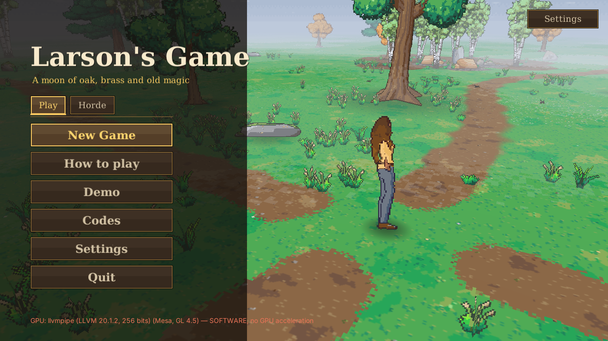
  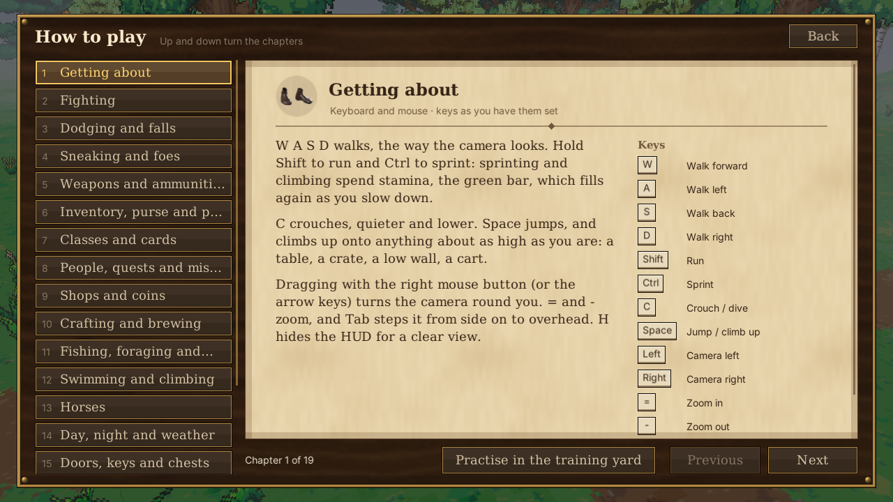
</p>

The main menu is tabs - **Play** and **Horde**, and in dev mode **Cutscene**
and **Dev** - over your own character in the meadow, with the game's own tavern
anthem, "Lanterns Over Brasswick", playing for lute, fiddle and recorder. Your character **stands at ease** with empty
hands, weight on one leg then the other, breathing, glancing off to the side
(the new *at rest* stance, `AnimState.REST`), and now and then takes up a
weapon's ready stance - the blade, the staff, the bow, the mace, the dagger,
the wand, the axe, the crossbow - for a few seconds before setting it down,
turning a little as they go. **Play** has *Continue*, *New Game*, *Load Game*,
**How to play**, *Demo* (the training yard: dummies, every weapon, a chest,
the highlands), **Codes**, *Settings* and *Quit*. **Settings** sits at the top
right of every screen.

**Codes** is where the dev code goes: type **1 0 2 5** (the number row or the
num-pad) or tap it on the page's keypad with the gamepad, then **Enter**.
Dev mode shows the **Dev** tab (Creative Mode, the world map and horde map
editors) and the **Cutscene** tab, and **unlocks every cosmetic** - every
hairstyle, garment, piece of armour and colour - in the wardrobe; the same
page turns it off. It is remembered between runs (`devUnlocked` in
`config/settings.json`). Without the code the cutscene is not offered at all.

**World maps** are picked per save slot. *New Game* asks which world map the
playthrough is on - **Main story: the Brass Vale** first, then every map made
in the map editor - and *Load Game* has a picker beside each slot to take
that playthrough onto another map; each map remembers where she stood on it,
so going back puts her where she left off.

<p align="center">
  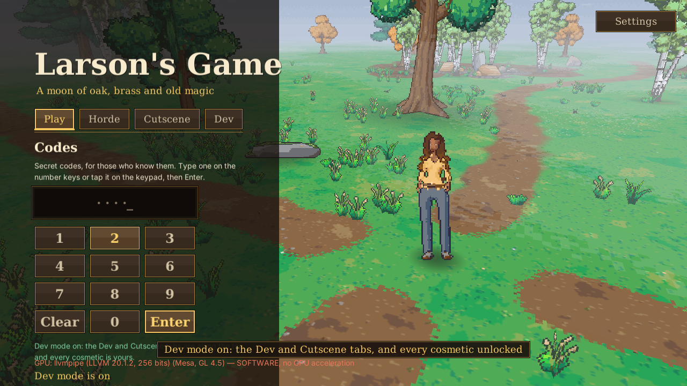
  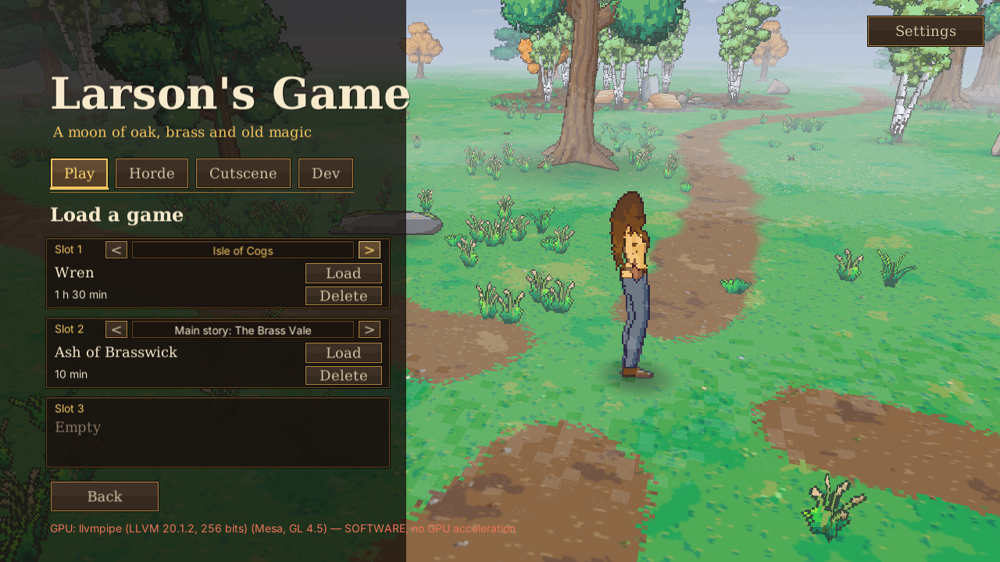
</p>

### A playthrough

<p align="center">
  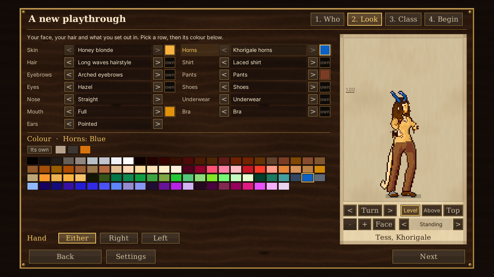
  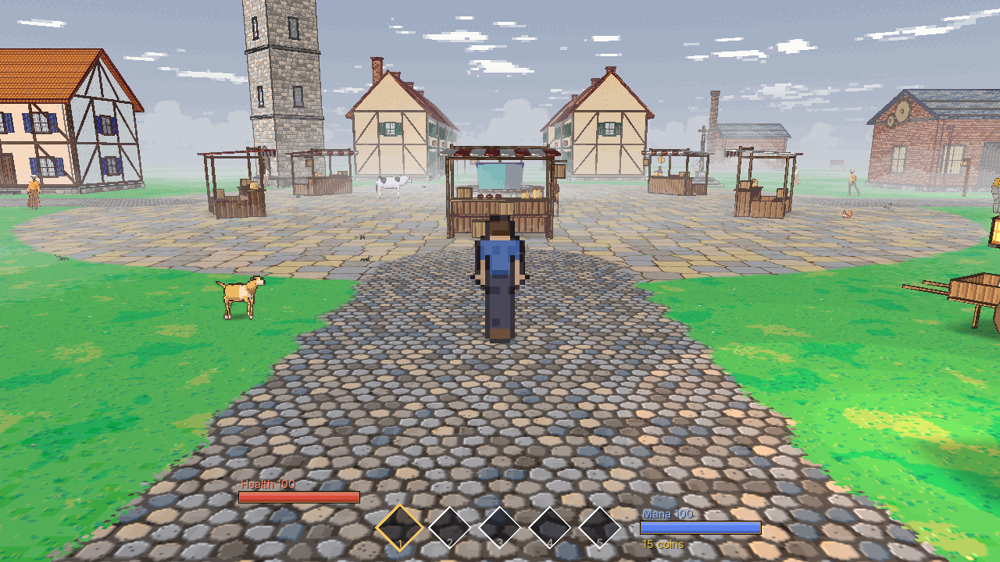
</p>

- **A new game** (`scene/CreatorScene`) is four pages in one layout - **Who**,
  **Look**, **Class** and **Begin** - with their tabs along the top, so any
  page is one click (or **LB** / **RB**) from any other, and **Back** and
  **Next** at the foot. *Who*: your name, **Your People** (Human, Drurinean,
  Half Drurinean or Khorigale), body, skin - your people's usual tones or
  **any colour of the palette** - and height (0.7 to 1.3 of the usual).
  *Look*: face, hair, horns and tail and each one's colour (every hair
  colour is open from the start), and the clothes you set out in: a laced
  shirt, **brown trousers** and boots. *Class*: the nine, each with its
  deck and first weapon. *Begin*: the summary, and off you go.
- **The portrait** beside every page (`scene/Portrait`) is your character in
  a frame fitted to them: **turn** them (the arrows, a drag, or let them
  spin), look from level, above or the top, **zoom** in with the wheel or
  **+**, switch to the wardrobe's **animated close-up** (**Close up**: face
  and shoulders at rest, breathing and glancing, turning by itself or by the
  arrows and a drag, from all eight sides, in the clothes and colours picked),
  and step through poses - standing, walking, the attacks, parry, guard,
  shield bash - with the class's weapon in hand (a sword and shield until a
  class is picked, and for any move the class's weapon has none of, such as
  a staff's shield bash or a lone sword's guard).
- **Every playthrough starts clean**: its own purse, bag, cards, missions,
  map, clock, tips and what has been seen of each level; nothing of another
  playthrough, and the debug code off.
- **The map** (`scene/OverworldScene`) is walked like a platform game's: the
  move keys or the stick take the road that sets off that way, a click walks
  her to a place, **Use**, **Jump** or **Enter** goes in. The roads on from a
  place open once it is **cleared** - by reaching it, by its way out, by
  felling its foes or finishing its quest, as the map says. The places a
  mission you follow is to be done at are **marked**. **Esc** (or **View** /
  **Menu**) opens the map's menu: back to the map, save and quit, settings,
  and **Reset the map** - every place uncleared, its chests full again, and
  you back at the start.
- **Saving** is automatic (`save/SaveGame`): her place on the map when she
  arrives somewhere, and all of her - what she carries, her purse and pouch,
  class, cards, level, missions, the doors opened and the chests emptied,
  **the hour and the day**, and what she has seen of each level's map -
  when she comes back from a level. Three slots, `config/saves/`.

### Finding your way

<p align="center">
  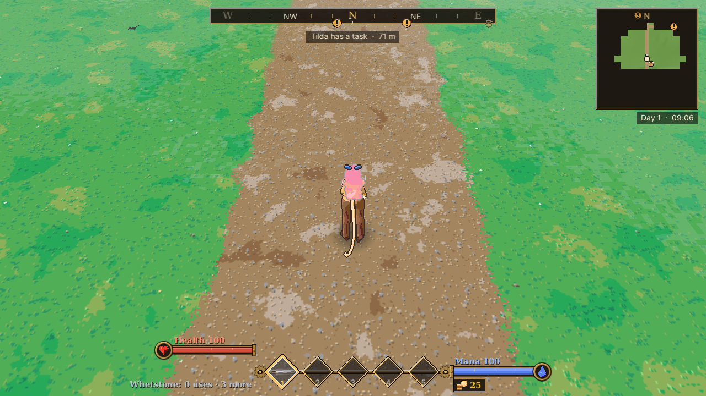
</p>

- **The small map** in the top corner (`scene/MiniMap`) draws the level as
  you **discover** it: the ground, water, roads and buildings within sight of
  where you have been, dark everywhere else. What you have seen is kept with
  the playthrough, level by level. Under it, the day and the hour.
- **The compass** along the top (`scene/Compass`) turns with the camera - N,
  NE, E ... - and carries a mark for each **waypoint near you**: the missions
  you follow (with how far), people with work for you, shops, doors and the
  way out.
- **Missions you follow stay followed** from level to level: one taken in a
  village is still listed, with where it is to be done, in the next town,
  and its place is marked on the map between them.

### How to play, and tips

**How to play** (Play tab, and the pause menu) explains every mechanic in 19
chapters - getting about, fighting, dodging, sneaking, ammunition, the
inventory, cards, people and missions, shops, crafting, fishing and hunting,
swimming and climbing, horses, day and weather, doors and keys, the map and
saving, the horde, Creative Mode, settings and controls - each page with the
keys it talks about drawn as they are bound *now*, on the keyboard or the
controller, whichever was touched last. Up and down (or LB and RB) turn the
chapters; *Practise in the training yard* goes to the demo.

In the game, **tips** come up once each the first time something happens -
her first steps, a foe near, someone to talk to, a chest, deep water,
nightfall, a storm, being hidden, a new mission, running out of ammunition
(`scene/Tips`). Settings → Game turns them off, or shows them all again.

<p align="center">
  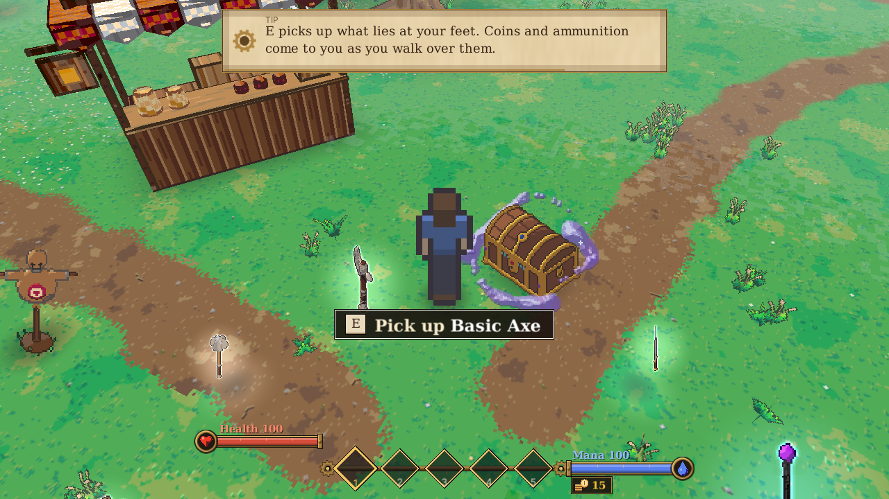
</p>

### Controls

Every key and button can be changed in **Settings → Controls**
(`config/controls.json`), two keys and two gamepad inputs each. An Xbox-style
controller works everywhere, and the prompts on screen follow whichever was
touched last.

| | Keyboard and mouse | Controller |
|---|---|---|
| walk / run / sprint | **W A S D** / hold **Shift** / hold **Ctrl** | left stick / - / **L3** |
| crouch, dive | **C** | d-pad down |
| jump, climb up, come up | **Space** | **A** |
| dash (tap) / combat roll (hold) | **Left Alt** or **Z** | **B** |
| attack (bow: hold to draw) | **left click** or **F** | **RB** |
| heavy attack / spin attack | **X** / **R** | **RT** / **Y** |
| block (held) / parry / shield bash | **B** / **Q** / **V** | **LB** / **LT** / - |
| lock on / next target | **L** / **K** | **R3** / - |
| use, pick up, talk, open, go in, ride | **E** | **X** |
| drop what she holds | **G** | - |
| hotbar | **1 – 5**, the wheel | d-pad left and right |
| inventory / cards / missions | **I** / **J** / **U** | **View** / d-pad up / the inventory's *Missions* |
| camera: turn / zoom / height | right-drag or arrows / **+ −** or the wheel while turning / **Tab** | right stick / - / - |
| time-lapse (held) | **N** | - |
| laugh, cry, surprise, anger | **F1 – F4** | - |
| hide the HUD | **H** | - |
| pause | **Esc** | **Menu** |
| settings, anywhere / full screen | **F10** / **F11** (or Alt+Enter) | - |
| screenshot / performance overlay | **F12** / **F8** | - |

**In menus** a controller moves a focus ring between every button, slider,
choice and text field with the d-pad or the left stick; **A** presses, **B**
goes back, **LB** / **RB** change tabs, the right stick and the triggers
scroll, a focused slider turns with left and right, and text is typed on an
on-screen keyboard. Where a screen wants a pointer - the map, the editor's
view - the left stick moves one (**L3** switches it by hand). The button
that opened a menu does not shut it again until it is let go and pressed
once more, so the pause menu and the map's menu stay up.

**The inventory and the cards** are worked the same way: the focus rests on
a slot - **A** takes up and puts down, **X** is the right click (eat, a
weapon's tiers, to or from the hotbar), **Y** drops what is held, **View**
or **B** shuts it - and on a card of the hand: **A** plays it, **LB** /
**RB** turn to the deck and the perks, **B** goes back to the game. The new
game's pages, the wardrobe and every colour grid work from the d-pad too.

A few more for looking at the art: **[ ]** play each animation in place,
**Backspace** stops, **, .** turn her, **T** turntable, **O** the automatic
camera height, **P** hide the scenery, **F7** the sheets on screen, **F9**
the first version of the weapon moves.

### Settings

<p align="center">
  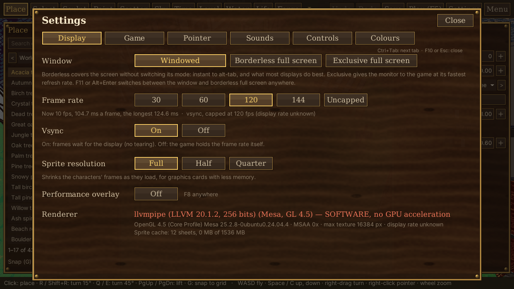
</p>

One settings menu (`scene/SettingsMenu`) opens over **every** screen - the
menu, the game, the map, the character creator, the editors - with **F10**
or the **Settings** button, and saves as it changes (`config/settings.json`):

- **Display**: windowed, borderless full screen or exclusive full screen (at
  the monitor's fastest refresh), the **Graphics** - **Auto** (Lite on a
  low-end machine, Full otherwise), **Full** or **Lite**, [below](#low-end-machines-the-lite-graphics) -
  the frame rate (30, 60, 120, 144 or uncapped), vsync, the world's resolution
  (Full, 3/4, Half), the view distance (Far, Medium, Near), wildlife and
  weather (Lots, Some, Few), anti-aliasing, sprite resolution, the performance
  overlay, and what the renderer is.
- **Game**: the HUD and the missions on it, tutorial tips, picking up by
  walking over (and how near), the camera's height, walls indoors and out,
  scenery and animations.
- **Pointer**: **Default** - an **arrow of gears** (brass and iron cogs)
  everywhere, and her class's own pointer in a story where she chose a class
  (`ui/Pointers`) - or the gear arrow always, any class's, a picture of your
  own or the system's, and whether it changes with what it is over - a hand over
  buttons, a speech mark over someone to talk to, a sword over a foe, a key
  over a lock, a coin over a shop, a beam over loot.
<p align="center">
  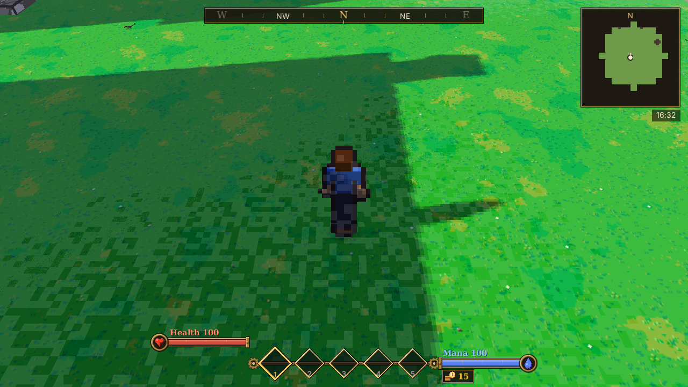
  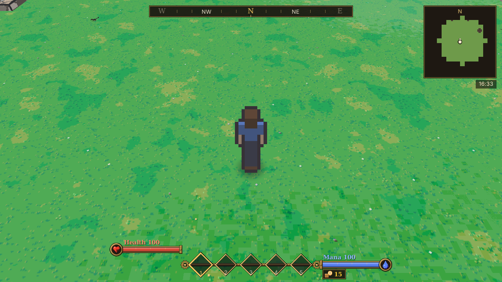
</p>

- **Vibrant visuals** (Display): on as it comes, at 75 % strength (a slider
  from none to all) - warm sunlight and cool shade, buildings lit from where
  the sun is, richer colours, and **light rays** through the trees, past the
  walls and in the mist, worked out from the sun and the shadows (no longer
  something placed). **Shadows** Off, Low, Medium (as it comes) or High: every
  placed thing - buildings, furniture, trees, rocks, folk and animals - casts
  the sun's shadow the way the sun is, longer in the evening.
- **Sounds**, **Controls** and **Colours**: below. The birdsong in the
  daytime is a sound of its own, **Ambient → Birdsong**, muted or swapped
  like any other.

**F11** (or Alt+Enter) switches between the window and full screen anywhere,
and the choice is kept for the next start.

---

## Moving about

- **Walking, running, sprinting** - stamina (the yellow bar) goes on
  **running** (3 a second) and more on **sprinting** (8), on climbing and on
  swimming fast, and comes back as she walks or stands. Run it out and she is
  **out of breath**: she walks until a quarter of it is back. **Crouched** she is
  low and quiet. Ground steeper than she can walk up stops her; rock is rock.
- **Jumping and climbing up**: **Space** by a table, a bench, a crate, a low
  wall - anything up to about her height - and she climbs up onto it; she
  stands on furniture up to 2 m tall. Gear forged with a **double jump**
  lets her jump once more in the air (its own animation, then a **fall**
  animation all the way down), and **jump** gear sends her higher.
- **Falls** of more than 3 m hurt, more for every metre. The dodge key in the
  air lands her in a roll, unhurt. Water breaks a fall.
- **Vines** on a cliff, and **ladders** (wooden, iron or rope, placed in
  Creative Mode against anything), are climbed (forward up, back down,
  sideways along a vine); at the top she steps up over the lip, and walking
  off the top she turns and climbs down.
- **Swimming**: in water deeper than she stands. **C** dives and **Space**
  comes up; under the water she swims where the camera looks, the view tinted
  and muffled, a breath bar going, and she drowns when it runs out.
- **Riding**: with a saddle, **E** by a horse saddles it and **E** again rides
  it - a walk, a canter (Shift) and a gallop (Ctrl), turning no faster than a
  horse can. A saddled horse waits where she left it.

<p align="center">
  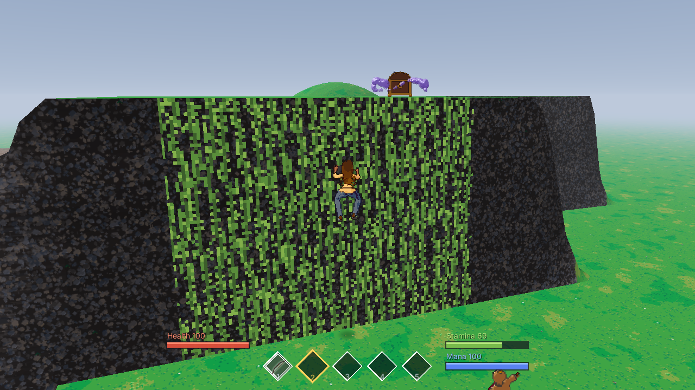
  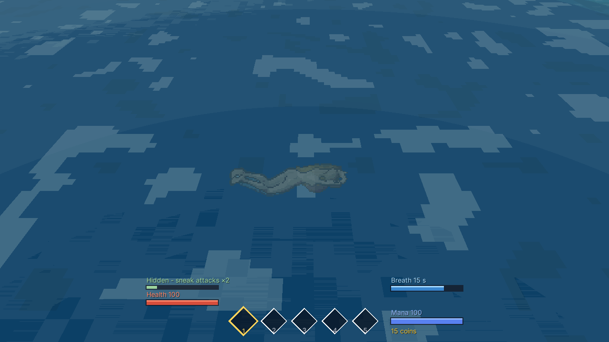
  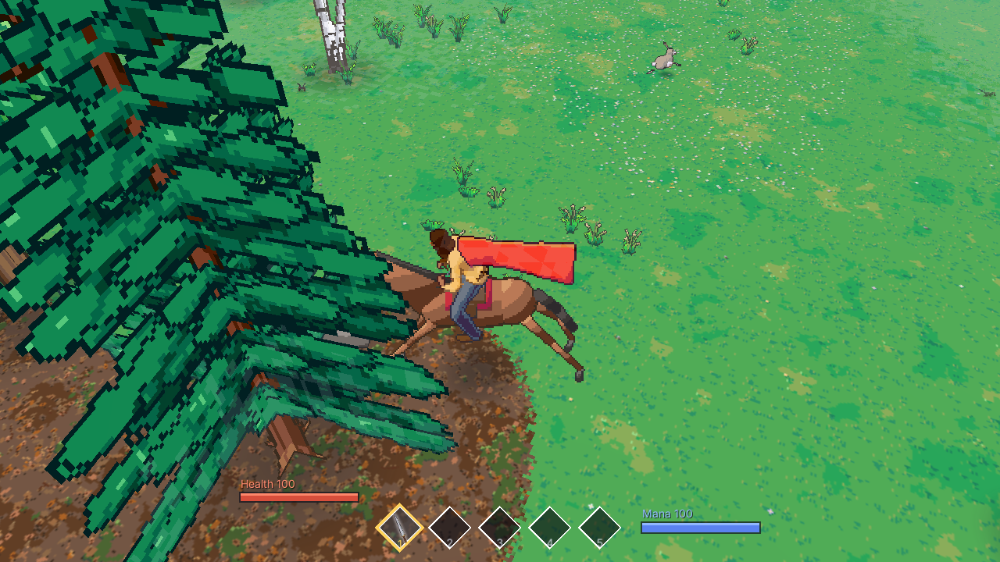
</p>

<p align="center">
  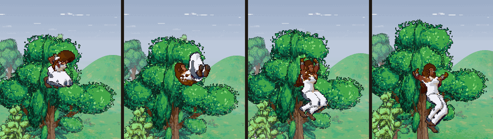
</p>

## Fighting

<p align="center">
  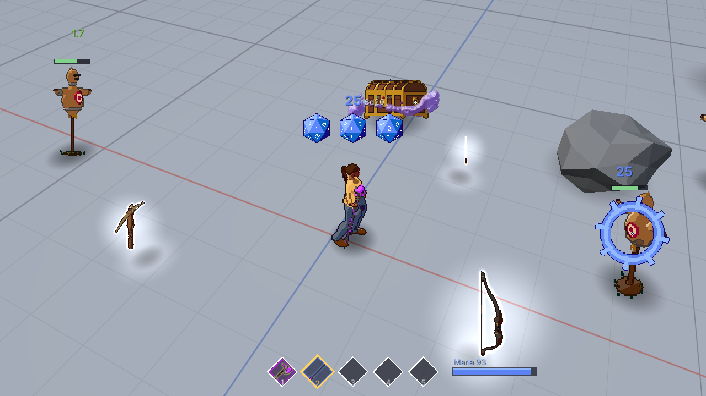
  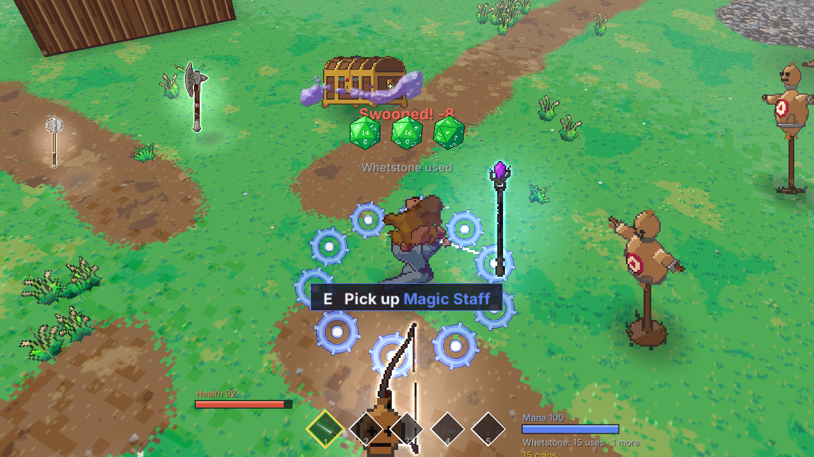
</p>

**Eight weapons**, each its own stance - idle, walk, run, jump, crouch and its
moves: the **sword** (with a shield, or alone), the **battle axe**, the
**longbow**, the **crossbow**, the **crystal staff**, the **wand**, the
**mace** and the **dagger**. What is in the selected hotbar slot is in her
hands; an empty slot is her bare hands. A left-handed character fights
left-handed.

- **The dice.** Every blow rolls dice over her head, in the colour of the
  weapon's rarity - **one for Common up to six for Mythic** - and their total
  is the damage, floating up off what was struck. Their sides are the
  weapon's: bare hands **D4**, a dagger **D6**, a sword, an axe or a mace
  **D8**, a bow or a crossbow **D10**, a staff or a wand **D12**. Over a weapon
  in the inventory, its **damage per second** (roughly: its dice on average
  over how long an attack takes, at its rate of fire). A **heavy attack** (X) rolls
  a die more, once every 10 seconds; the **spin** strikes all round her; a
  **jump attack** - attacking in the air - comes down on everything round her
  with a die more.
- **Stamina**: a sword's, a mace's, an axe's, a dagger's or bare hands'
  every blow costs it - a swing 6, a heavy attack 14, a spin 12, a jump
  attack 10 (`assets/combat/combat.json` `stamina`; a forged weapon's own
  **Stamina use** in the Forge scales it). With too little left the blow is
  **tired**: "Out of stamina", and **70 %** of its damage. **A bow and a
  crossbow cost no stamina.**
- **Mana**: a **wand** and a **staff** draw mana, never stamina - a spell 10,
  any other blow of theirs (a wand's heavy blow, a Basic Staff's thrust) its
  stamina number's worth of mana; short of it a spell fizzles and a blow is a
  tired one. Her **mana** refills, 5 a second. A forged one's **Mana use**
  in the Forge scales all of it (×0 to ×4).
- **Bows, crossbows, wands and staffs** shoot: arrows and bolts arc onto what
  she faces, spells fly straight. At what flies, or what is well above her,
  she **aims up**; from **the high ground** (2.5 m or more above) a shot
  rolls a die more.
- **Full auto**: a wand or a staff forged to fire full auto streams small,
  quick **bolts of magic** for as long as the attack is held - **6 a
  second** unless the Forge says otherwise (1 to 20), each rolling the
  weapon's dice and drawing **2 mana** (`mana.autoBoltCost`). She fires
  walking, running, jumping or standing (holding the cast's pose); it never
  roots her. Out of mana, it sputters as the pool refills; one use of a
  crystal lasts six bolts. `assets/forge/sparkstream.json` is one to try
  (Legendary, 2d6, 8 bolts a second).

<p align="center">
  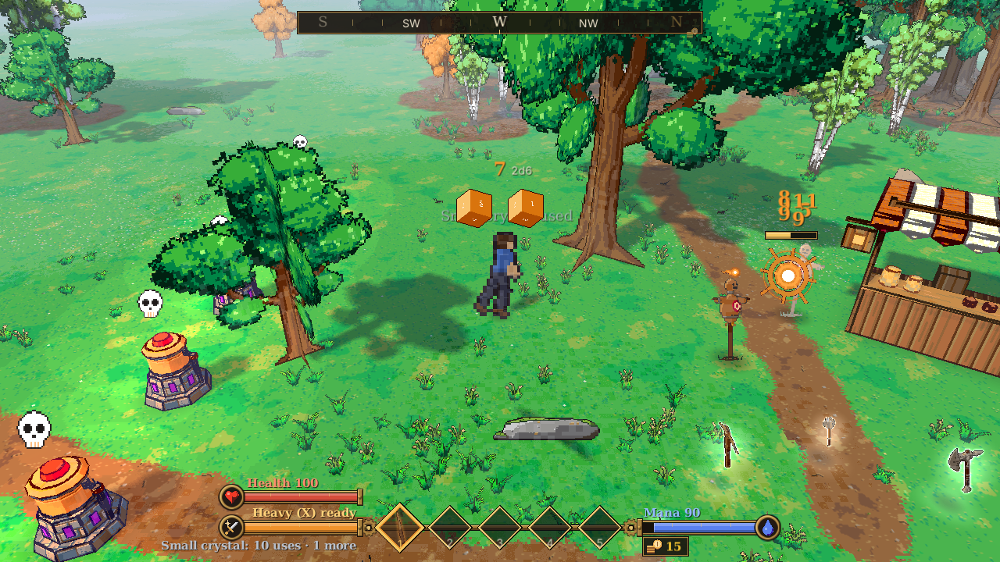
  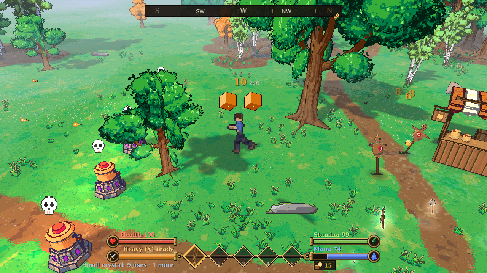
</p>

- **Defending**: hold **B** to block (the shield up, or the weapon across),
  **Q** parries a blow just as it lands, **V** bashes with the shield.
- **Shields** (`world/Shields`): twelve, carried on the off-hand arm with
  any one-handed weapon - the sword, the mace, the wand or the dagger, which
  then fight in the sword-and-shield moves; a two-handed weapon puts the
  shield away while she holds it. Raised, a shield rolls its own **block
  dice** against every blow **from the front** (within its arc), on top of
  the block's half and before her armour rolls; a blow from the side or
  behind gets past it. Each point it holds costs stamina, and out of stamina
  the guard breaks. Its bash rolls its own **bash dice**. Past the round
  shield, each has a gift: the wicker shield's blocks cost no stamina, the
  buckler parries a blow met as it is raised, the targe's bash rolls more
  dice, the heater halves the stamina, the kite shield stops shots from the
  front whole, the spiked shield deals a blocked blow back, the tower shield
  covers her sides too, the gear shield bashes all round her, the lantern
  shield lights the dark round her (and shows her up when she sneaks), the
  mirror shield sends shots and spells back, and the crystal aegis turns
  half of what it blocks into mana. Put one on or away by right-clicking it
  in the inventory (pad X), by picking it under **Shield** in the
  wardrobe's Armour tab, or with its hotbar number (a shield on the hotbar
  goes on her arm and the weapon stays in her hand; the wheel and the d-pad
  pass over it). One picked up goes straight onto a bare arm, and the Knight
  starts with the round shield. It needs no weapon: with her hands empty
  she carries it all the same, raises it and bashes with it. A two-handed
  weapon puts it away, and the game says so. The Tailor makes shields of
  one's own (their dice, tiers, gifts, colours).
- **Dodging**: a tap of the dodge key **dashes** 3.5 m; held, it becomes a
  **combat roll** of 4.7 m in which nothing can hurt her - she rolls through
  her foes.
- **The lock-on** (**L**) brackets the foe nearest the middle of the view:
  the camera keeps it in sight, swings turn to it, shots lead it. **K**: the
  next one.
- **Sneaking**: crouched, still, in tall grass, at night, in fog, rain or snow
  or under the water she is harder to see. **Hidden** (the eye over the
  stamina bar shut), her blows are **sneak attacks**: twice the damage - but
  only while **nobody has spotted her**: a foe or a person who sees her now, a
  foe out after her (even one searching), or an animal coming at her. The
  line over the bar says so ("Hidden, but spotted - no sneak attacks").
  - **Light at night**: the night hides her only where it is dark. A lamp, a
    fire in a hearth, an open chest's glow, glowing crystals and trees - and
    her own lantern most of all - show her to anyone looking ("· in the
    light"). Caves are dark all day.
  - **Stamina**: the crouch walk costs stamina (2 a second, 5 hurrying with
    Shift); run out and she creeps along slower until it comes back. A jump
    costs 6 and her gear's second jump 8: too tired, she does not jump.
  - **Gear for it**: the Tailor's **Sneaking** effects - Stealth, Sneak speed,
    Quiet steps, Shadow (lights show her less), Sneak stamina and Sneak attack
    (more sneak attack damage).

<p align="center">
  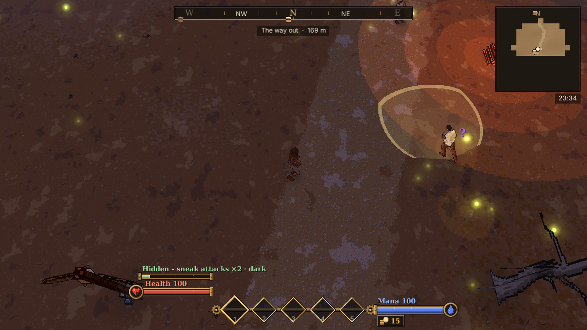
  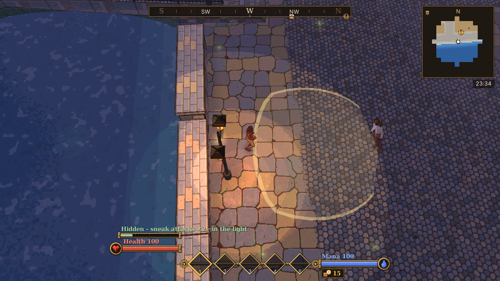
</p>
<p align="center">
  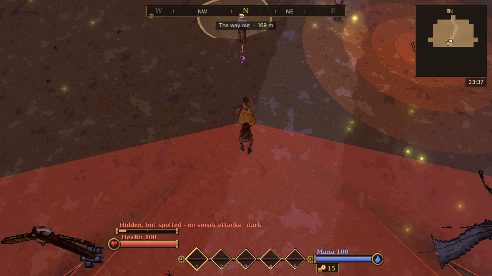
</p>
- **Rare borders**, one weapon in a hundred: **Venom** (half the damage again
  as poison), **Mystic** (×2.5 damage for twice the mana), **Bloodlust** (+10 %
  for every living thing it has struck in five minutes).
- **Ammunition**: every weapon wears something out - whetstones for the sword
  and dagger, iron wedges for the axe, studs for the mace, arrow and bolt
  bundles, small crystals for the wand, large ones for the staff - one every
  dozen blows or so. Without it a blade strikes dull (half), and a bow, a
  crossbow, a wand or a staff will not shoot. It lives in her **pouch**
  ([below](#the-inventory-purse-and-pouch)).
- **Tiers and upgrades**: the weapons come in tiers - the sword Basic,
  Sharper, Crystal, Perfect, Mythic; the staff Basic, Magic, Honed, Perfect,
  Mythic; and so on (`world/Tier`) - each its own look, drawn by recolouring
  the same sprites. A forged weapon's tiers (2 to 10) are upgraded with
  **upgrade ingots**: right-click it in the inventory. **Every piece of
  clothing and armour has tiers too**, and gives more at each
  ([the Tailor](#the-tailor)).
- **Forged weapons** ([the Forge](#the-forge)): any of the eight with its own
  name, rarity, colours part by part, dice - how many of a **d4, d6, d8, d10,
  d%, d12 or d20**, and up to four more groups that **add, subtract,
  multiply, divide or scale** the total - and any of the three borders.
  Borders are for weapons only; armour and clothes give **gifts**
  ([the Tailor](#the-tailor)).
- **Armour rolls to block** (`world/Armour`): a blow lands on her **head,
  torso, arms, legs or feet** (torso most often), and what she wears there
  rolls its dice **just above the hotbar** - leather and padding a **d4**,
  chainmail, bronze and scale a **d6** to **d8**, iron a **d8**, steel a
  **d10**, the gilded great helm a **d12** - one die for Common to Rare, two
  for Epic and Legendary, three for Mythic. The total comes off the blow;
  roll as much as it and **"Armour held!"**. Armour has **tiers** too
  (Plain, Reinforced, Riveted, Tempered, Perfect, Mythic: each a rarity up,
  and darker, harder metal), upgraded with ingots like a weapon, each tier
  giving more worn ([the Tailor](#the-tailor)), and the Tailor makes armour
  of its own. `assets/combat/combat.json`'s `armour`
  sets the dice per rarity, how often each place is struck, a minimum blow,
  and `everyPieceRolls` - every piece she wears rolling at once.

Felling a training dummy is practice: the demo's three straw dummies, two
**flying dummies** that dive at her, and dummies on the highlands to shoot
down at. Her **health** comes back five seconds after she was last hurt; at
nothing, she is knocked out and back at the start.

<p align="center">
  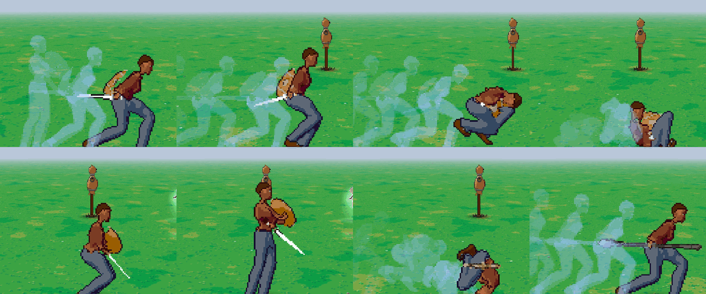
  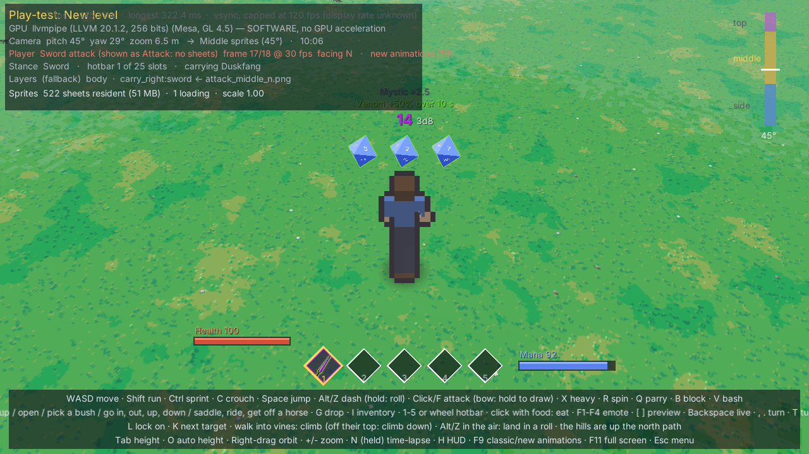
</p>

<p align="center">
  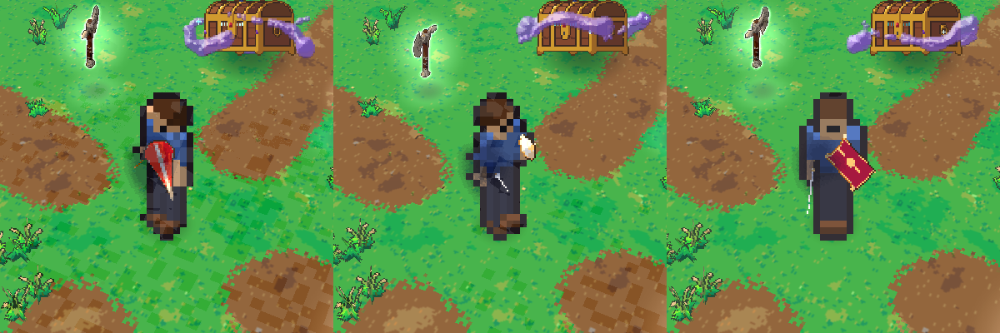
  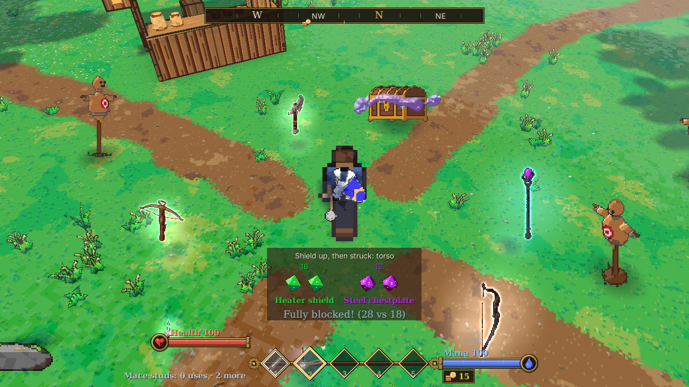
</p>

<p align="center">
  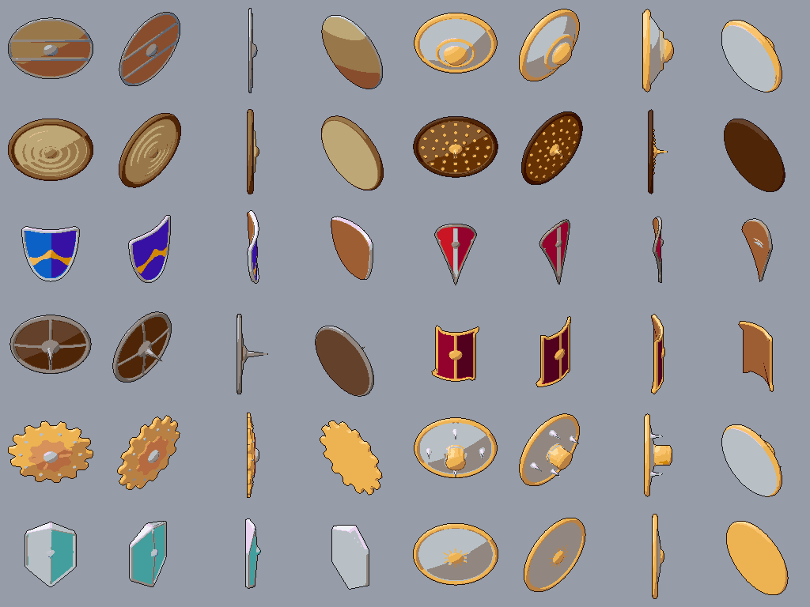
  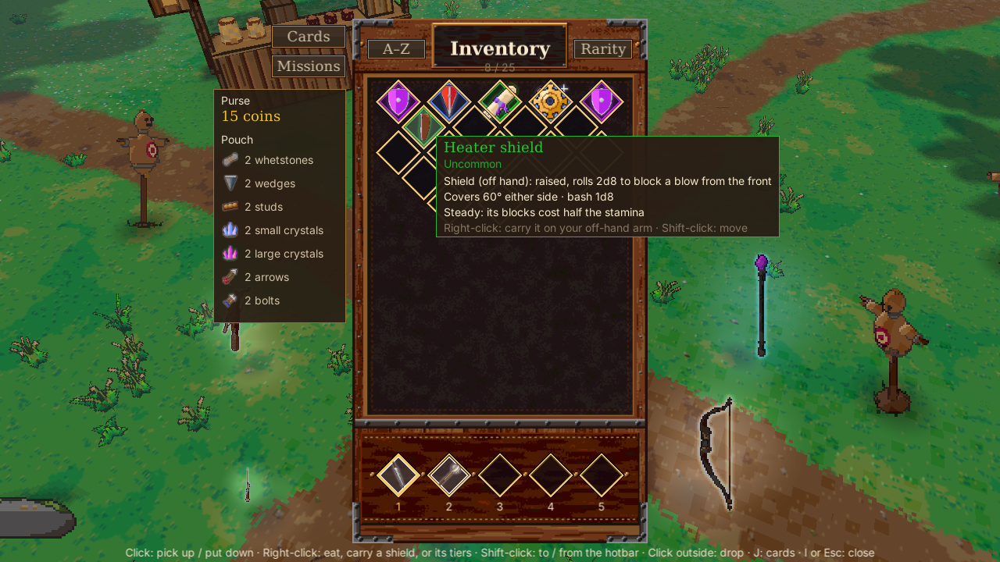
  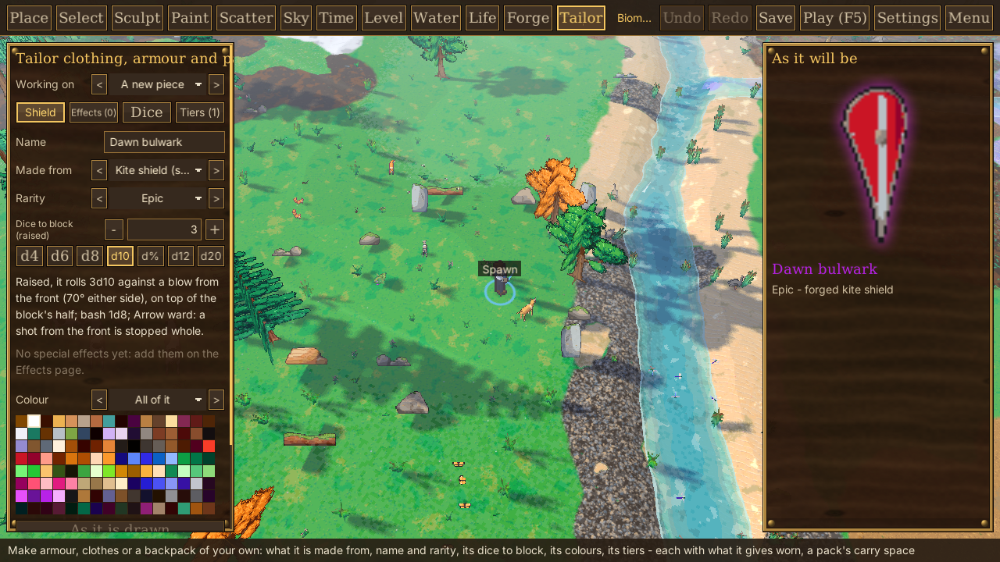
</p>

<p align="center">
  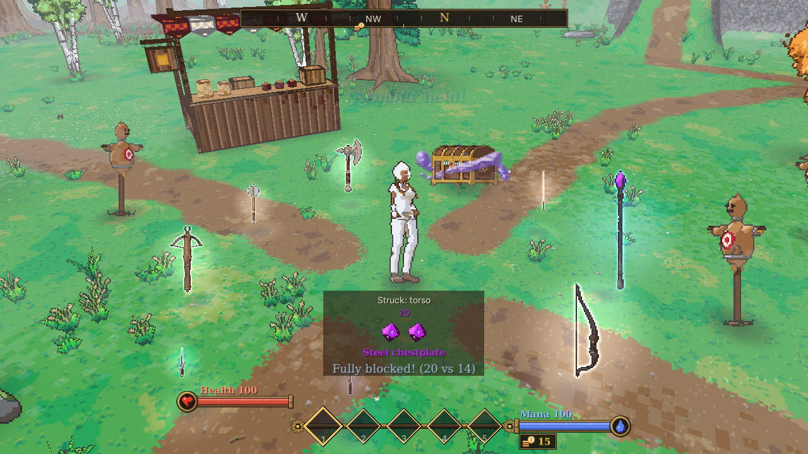
  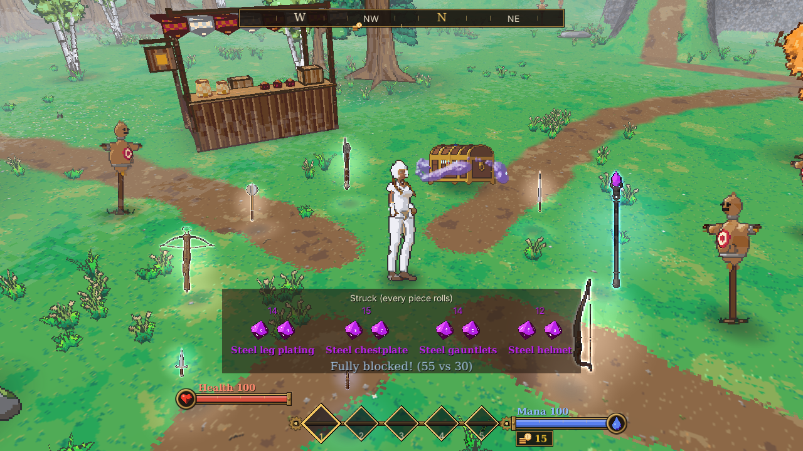
</p>

<p align="center">
  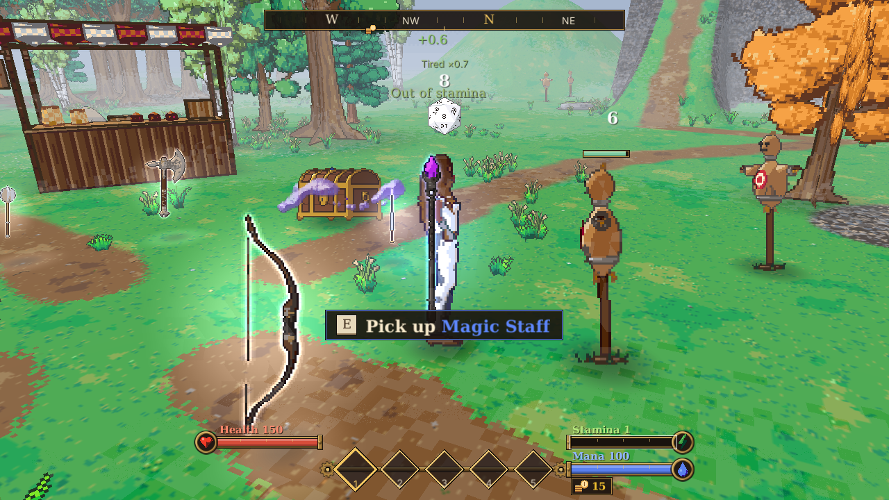
</p>

## Foes

<p align="center">
  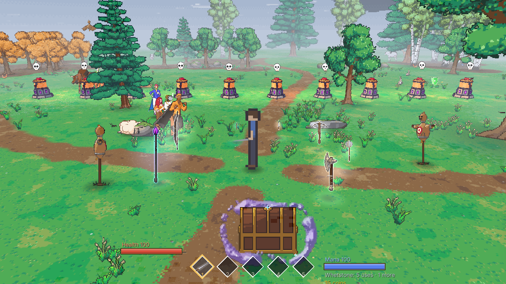
  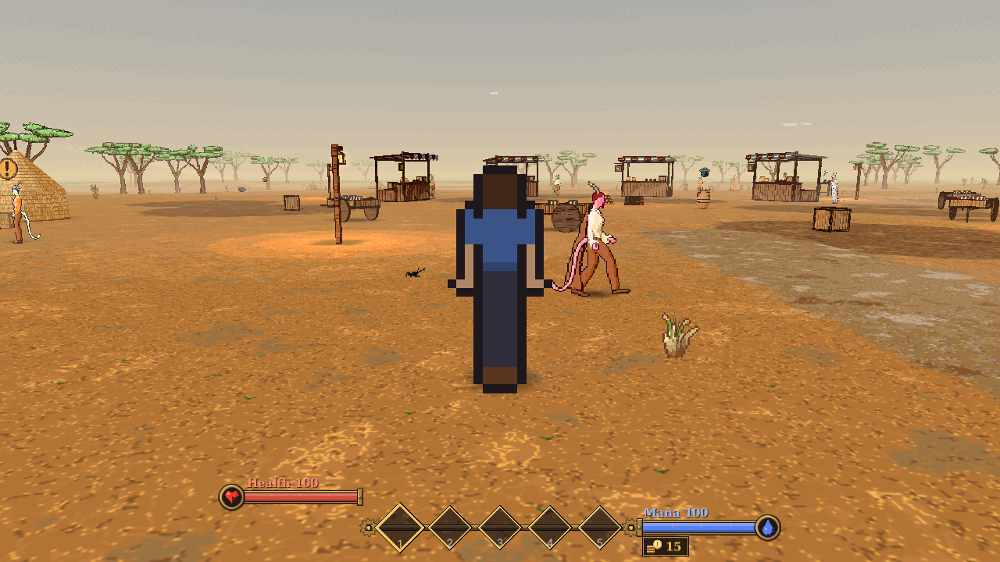
</p>

**The peoples** (`actor/People`, `actor/Looks`): Humans, **Drurineans** (tall,
long-eared), **Half Drurineans**, **Khorigale** (horned and long-tailed),
**Bortzal** (goblin yellow or ashy purple, half a person's height to half as
tall again) and **the Risen**. A person's look - skin, hair, face and clothes
in their people's way of dressing - comes from a seed, the same every time.

**Foes** (`actor/Breed`, `actor/Folks`): Bortzal, Drurineans with wands and
staffs, Half Drurineans with crossbows, Khorigale, bandits; six kinds of
Risen - walker, runner, brute, crawler, ghoul and the Risen Bortzal - on
sprites of their own, fighting with their hands; the **Vérnees** serpents
that come through **sky portals**; wild **boar** and **buffalo** that charge.
They close in, strike, loose arrows and spells, guard and dodge.

**How they find her** (`actor/Paths`):

- **Sight** (`actor/Sight`): its line of sight decides how far off it
  notices her. Within 30° of where it faces it sees as far as its kind does;
  toward the edge of its eyes (75°) less and less, down to 40 %; behind it,
  nothing. That reach is its sight times how easily she is noticed (crouched,
  the dark, a lamp's light - [sneaking](#fighting)), and only along a clear
  line from its eyes to her: not through a hill, a wall, a house, a tree's
  trunk or a rock - and a low rock hides her crouched but not standing. Once
  it is after her it sees all round, half as far again. People in the
  streets see her the same way (for the sneak attacks).
- **Hearing**: behind it, or too far to be seen, she may still be heard - a
  creep hardly at all, a sprint from far off. It stops, a **?** over it, and
  turns to look where the sound came from; if she is there to be seen, it
  sees her. So close it could touch her, it knows she is there whatever she
  does.
- **Its sight on the ground**: while she is crouched, each foe near her draws
  what it sees as a fan on the ground - pale gold unaware, amber listening,
  red once it sees her - cut short where a wall, a tree or a rock hides her.
  Pause → Settings → Game → **Foes' sight sneaking** hides it.
- **Losing her**, it goes to where it last saw her, searches about, then
  gives up and goes back.
- **The way round**: it walks round what is in the way - a house, along a wall
  to its gap, round a lake - by a search over half-metre cells, pulled
  straight wherever the line is clear, so it walks like someone who knows the
  way. Crowds spread out rather than piling up behind a wall.
- **Where a foot can go**: no steeper than she could walk up, never up a cliff
  or a wall, not into deep water. The high ground is hers to take.

In a level, foes are placed in Creative Mode (**Fight**): one foe, a band, a
**summoning station** that calls a band when used, or a **sky portal**, each
with its breed, size (0.5 to 1.5), weapon, name and health.

## Classes and cards

<p align="center">
  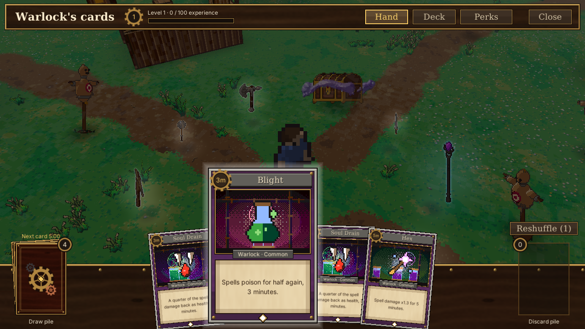
  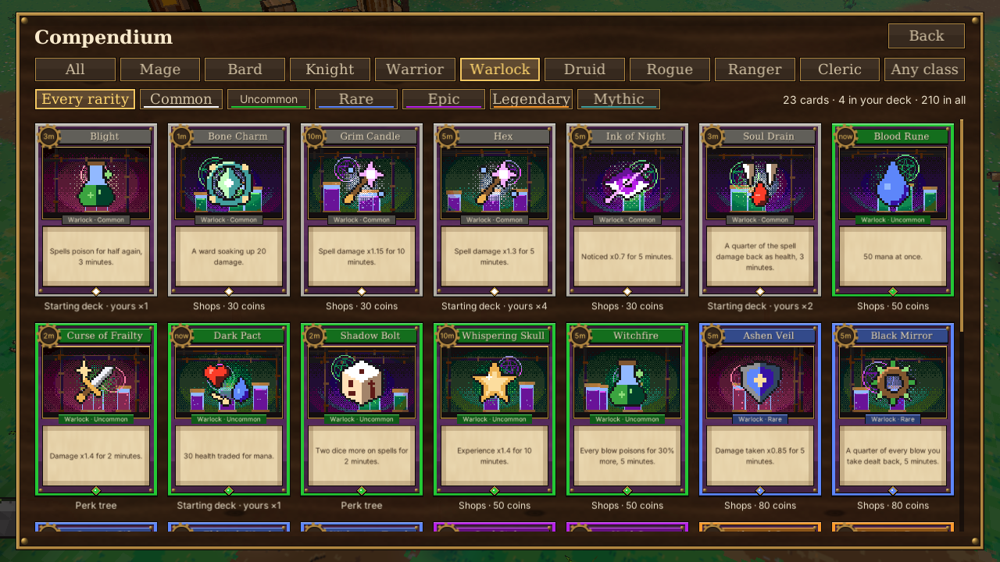
</p>

She is one of **nine classes** - **Mage, Bard, Knight, Warrior, Warlock,
Druid, Rogue, Ranger** or **Cleric** (`assets/cards/cards.json`) - each with
a starting deck of 8 cards and its own mouse pointer. **J** lays out the
**card table**: the game stands still, her hand fanned along the bottom; click
a card or drag it up off the board to play it. She starts with four in hand
and draws one more every five minutes; a **reshuffle scroll** shuffles her
discards back in.

**200 cards**, Common to Mythic, each with its rarity in its frame and a
background of its class: more damage on which blows, cheaper spells, faster
stamina, armour, thorns, lifesteal, poison, more coins or experience, a cloak
to hide in, and things at once - health, mana, a card drawn, coins. What her
cards are doing stands down the left of the screen with the time left on each.

**Experience** comes from felling foes and dummies, hunting, chests and
missions; each level brings a **perk point** for the class's **perk tree**
(four rows, on the card table). Shops sell more cards. **Pause → Compendium**
shows every card there is, by class and rarity, and where each is had;
**Pause → Class** changes class.

## What she carries

### The inventory, purse and pouch

<p align="center">
  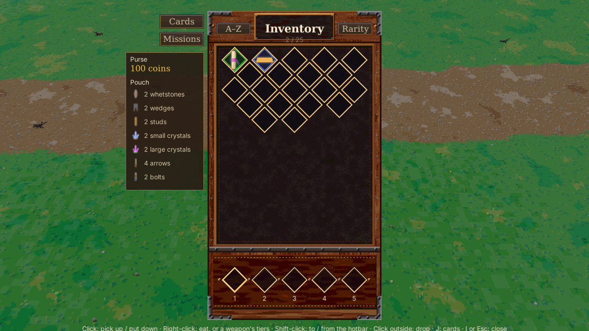
  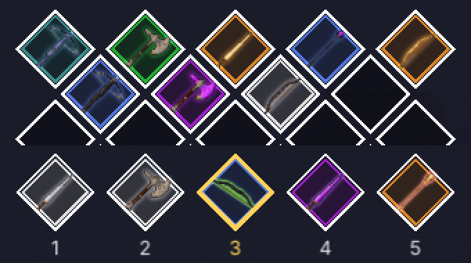
</p>

**I** opens the **inventory** (`world/Inventory`): 25 slots as diamonds in a
lattice on oak and leather, the **hotbar's** five along the bottom. Click to
take up and put down, right-click to move to or from the hotbar (or to see a
weapon's tiers), click outside to drop; **A–Z** and **Rarity** sort it.
Pickings, meat and makings stack. **Backpacks** are worn on the back (the
wardrobe's Back slot): the leather backpack adds 5 slots, and one made in the
Tailor adds what its maker set; satchels and explorer's packs still add slots
for good. A bigger inventory **scrolls** (the wheel, or the scroll bar), and
taking off a backpack never loses a thing - what no longer fits waits in the
slots past the end until there is room.

**Coins and ammunition never take a slot.** Coins go in her **purse**, and
whetstones, wedges, studs, crystals, arrows and bolts in her **pouch** - both
shown beside the inventory - however full the slots are. She takes them up
just by **walking over them** (Settings → Game: on or off, and how near);
everything else is picked up with **E**. Crafting and the weapons draw on the
pouch; an old save's ammunition in a slot is moved into it.

### Loot, chests and rarity

<p align="center">
  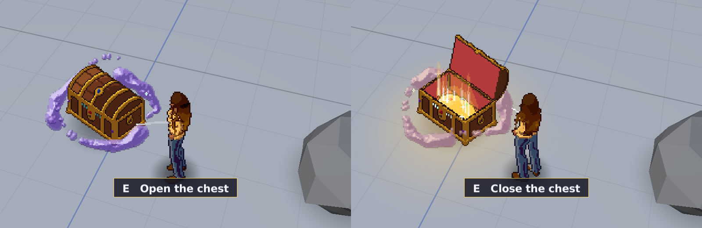
  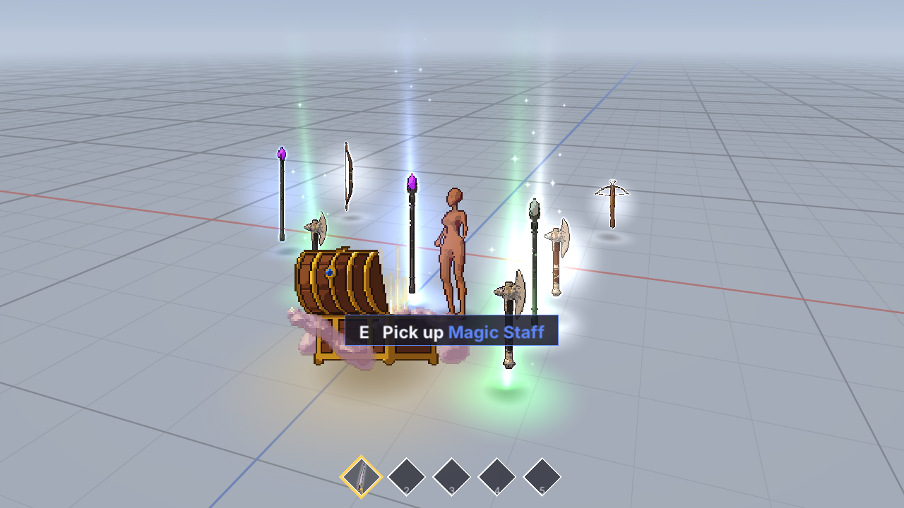
</p>

Everything has a **rarity** - Common (white), Uncommon (green), Rare (blue),
Epic (purple), Legendary (orange), Mythic (cyan) - shown in its glow, its
slot, its name and its beam. A **loot chest** throws out 3 to 7 items, one
Rare or better, each landing in a beam of its rarity's colour - **once**:
emptied, it stays empty (a playthrough remembers it). **Barrels, crates, pots
and storage chests** hold things to take and put in (**E**), and shatter into
pieces when struck, spilling what they held. About **one in three** has a few
coins in it - among what it holds, to be seen by looking in - and the rest
have none. Items turn in the air over their shadows, drawn from 128-pixel
sprites in their tier's colours.

### The wardrobe

<p align="center">
  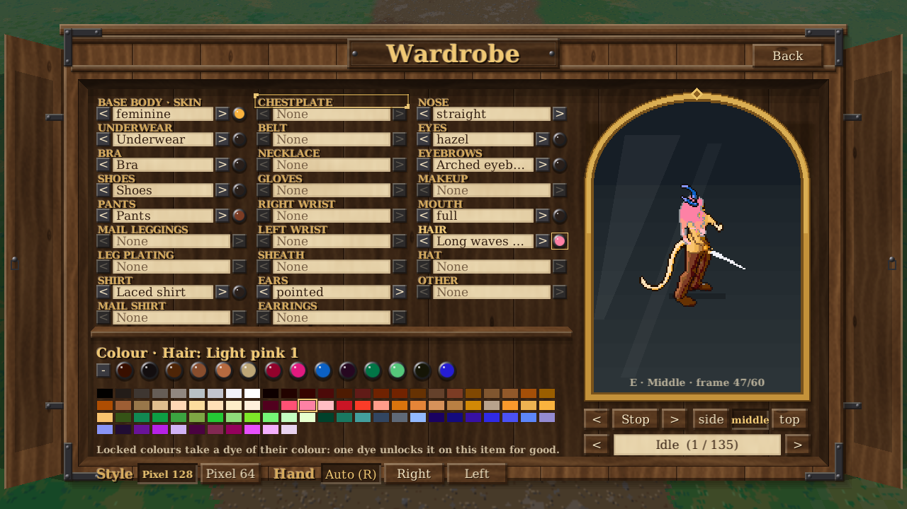
  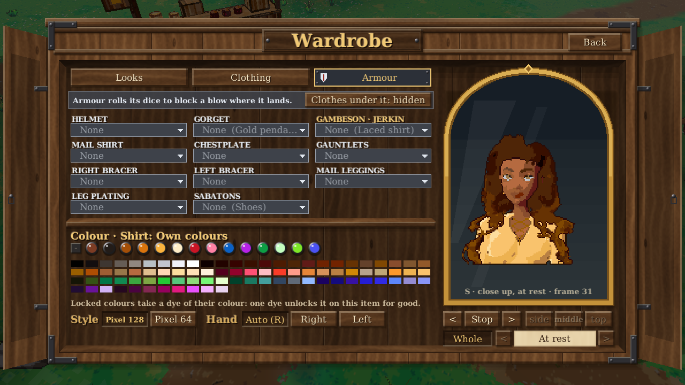
</p>

<p align="center">
  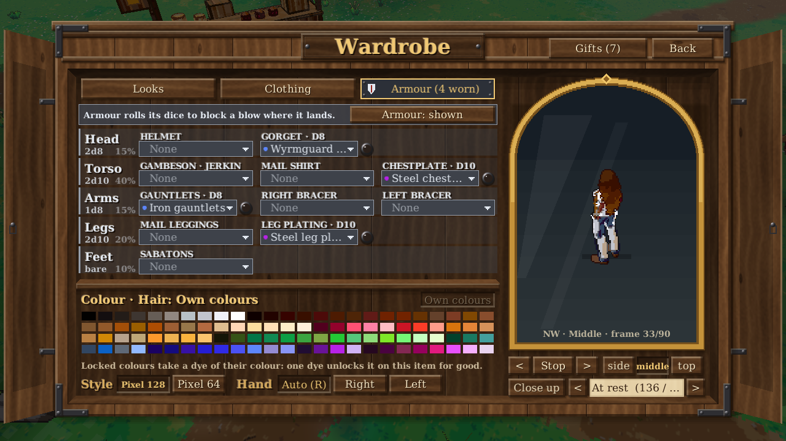
  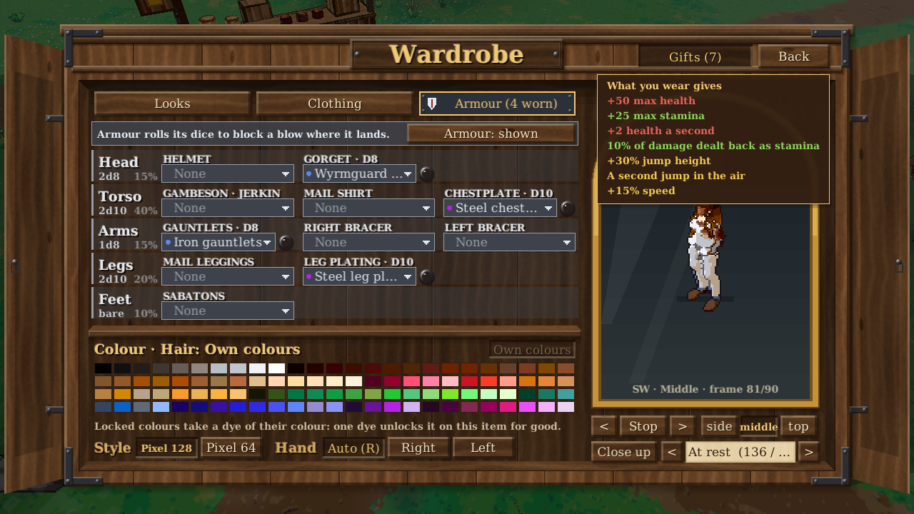
</p>

<p align="center">
  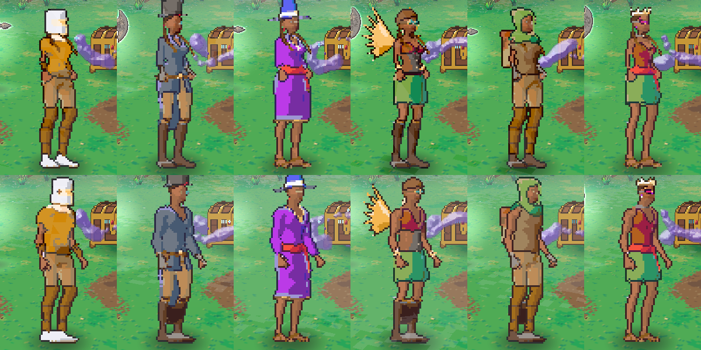
</p>

What she wears is **items** - clothes, armour (leather, chainmail, scale,
bronze, iron and steel), jewellery, hair styles, makeup, dyes - found in
chests and shops and put on in **Pause → Wardrobe**, an oak armoire with her
in its mirror, turning through every view and state.

- **Three sections**, a tab each (**LB** / **RB** on the gamepad): **Looks**
  (body and skin, hair, eyes, eyebrows, ears, nose, mouth, makeup),
  **Clothing**, and **Armour** - plated in iron, rivets and a little shield
  on its tab, so it is never mistaken for the clothes - **set out by the part
  of the body it guards**: **Head** (helmet, gorget), **Torso** (gambeson or
  jerkin, mail shirt, chestplate), **Arms** (gauntlets, both bracers),
  **Legs** (mail leggings, leg plating) and **Feet** (sabatons), each band
  with the dice that part rolls and how often it is struck, each piece with
  the die it rolls to block.
- **Armour goes over any clothes** (`sprite/Wardrobe`: the clothes are kept
  *under* the armour in the slots they share). A gorget over a necklace, a
  breastplate over a shirt, gauntlets over gloves: the armour is drawn, the
  clothes beneath are not, but **both are worn** - both count for what they
  were forged with - and the clothes row says "under the gorget". Take the
  armour off, or hide it, and the clothes show again.
- **Gifts** - the button by **Back** (there when anything she wears gives
  one) lists what everything she wears gives at its tier, upgraded pieces and
  her own alike ([the Tailor](#the-tailor)), each in its colour.
- **The armour bands** say what each part rolls to block ("2d10", or *bare*)
  and how often a blow lands there (torso 40 %, legs 20 %, head 15 % ...).
  Its header has **Armour: shown / hidden** - hidden, the armour is still
  worn (it rolls its dice, the Armour tab lists it) but it is not drawn, in
  the game or the mirror, and the clothes it would cover show instead (kept
  with her look, `armourHidden`).
- **Every layer is a dropdown**: click it (or **A**) and the list hangs under
  it (or over it, near the foot of the screen), with each item's rarity dot
  and an armour piece's die; the d-pad moves between the lists, **left /
  right** step through a list's choices without opening it, **A** picks,
  **B** shuts it. A long list **scrolls**: the mouse wheel anywhere over it,
  the bar at its side (drag it, or click above or below the handle), the
  d-pad (it follows the highlighted row), with "N more" above and below.
- **Every item is its own choice**: a garment cut in a named colour (the
  Herder's shirt, the Moonsilk gown) or worn in another metal (a bronze
  helmet, a gilded great helm) stays picked as itself, and a plain one picked
  after it is plain again.
- **One colour grid** under the lists: the whole 128-colour palette, with
  the item's own shades in it where their colour is (one that is in no
  palette colour sits beside its nearest) - no row of its own apart.
  **Own colours** (**Natural** for the lips) puts the item back in the
  colours it came in.
- **Close up** in the mirror brings her face and shoulders near, **at rest
  and moving** (her breathing, a glance, a blink), from **every one of the
  eight sides** - the mirror's arrows turn her, *Spin* walks her round
  (`assets/wardrobe_closeups/`, drawn from the same models as the sprites).
- **Whole** shows all of her again, in any state, from any of the three
  heights.

Among them, **54 added
for both bodies** (`world/Wearables` `outfitTable`): great helms, kettle
hats, horned helms, coifs, a wizard's hat, top hats, tricorns, hoods,
crowns, circlets and flower crowns; brass goggles, an eyepatch, a masquerade
mask and a monocle in a new **eyewear** slot; gorgets, amulets, cameo
chokers, scarves and earrings; gambesons, waistcoats, robes, frock coats,
breeches, pleated skirts, riding boots, sandals, sabatons and fingerless
gloves; bracers, brass gear cuffs, corsets, sashes and pouch belts; scale
mail, a leather jerkin and greaves, a backpack and clockwork wings - and
pieces in **bronze, gilded, blackened and silvered** metal. Every layer
takes its own few colours **and any of the palette's hundred**, set out in a
grid under them. **Dyes** unlock a colour on an item for good - the fourteen
named ones, from royal blue to green ombre, and one for every other colour
of the palette; the skin, the eyes, the hair and the eyebrows are free. Dyes
are **common** now: six times as likely in a loot pool, one or two more in
every chest, one felled foe in four drops one, about one breakable in five hides
one, and every shop has a few on its shelves. **Every piece takes dye, forged
ones too** - a forged gorget dyed red is still that gorget, with its gifts. Lips nobody has painted are the skin's
own colour, a little darker. Armour hides what it covers. Two bodies,
feminine and masculine, wear every item, in 128- or 64-pixel pixel art.

## People, their days, and missions

<p align="center">
  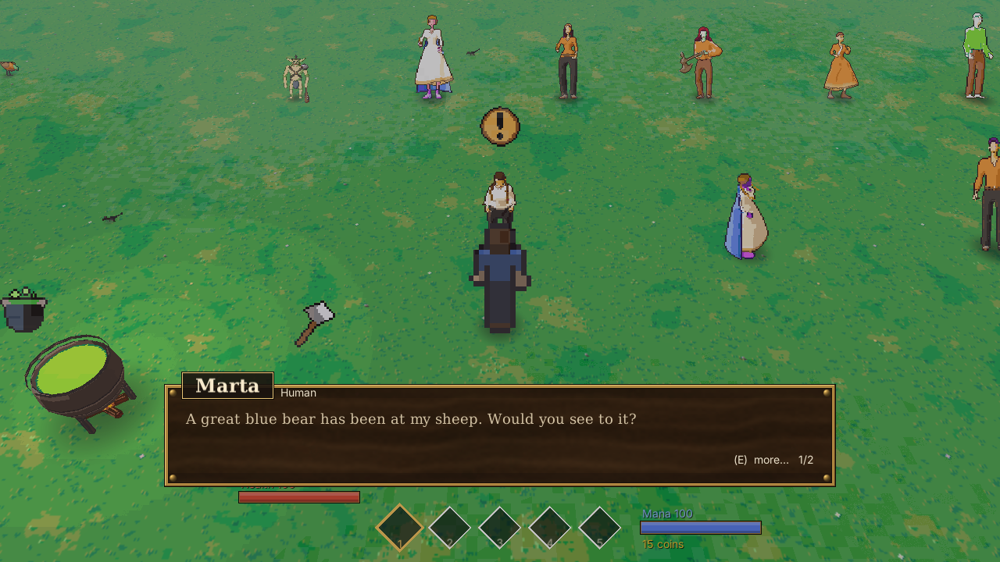
  
</p>

**Talking**: **E** by someone. They greet her, and she chooses what to ask
about; someone with a mark over their head has work for her. Shopkeepers
sell; some buy. Everyone's look - body, skin, face, hair, every thing worn
and its colour - is drawn from their seed, or **made by hand** in the editor.

**Their days** (`actor/Schedule`): everyone keeps a day, hour by hour - each
part of it *what* (stand, work, kneel and tend, keep watch, stroll, walk to
and fro, chat, go inside, sleep) and *where* (at their post, at home, at a
named spot, at a building). By default they keep to their posts by day,
stroll at noon, and **go home at night** - walking to their own door and in.
**In a storm** they go indoors and come out when it passes. In the morning
they come out of their doors and walk back to their posts. Go into a house at
night and the people who live there are inside, to talk to. Their homes are
picked in the editor, or the nearest house with a door is theirs.

**Missions** (`story/Quest`, `story/Quests`): quests are objects of a level -
who gives one, what to do, and what it pays (items, coins, experience).

| To do | Done when |
|---|---|
| **Fell** | so many of a kind - or someone by name - are felled, anywhere or within a ring |
| **Clear** | no foe is left in its ring (or the level) |
| **Talk** | she has talked to the one it names |
| **Bring** | she has so many of an item to hand over |
| **Reach** | she stands inside its ring |

A quest with an **id** is one quest wherever it is told (given in one town,
done in another), and one can wait for another. **U**, or *Missions* in the
inventory, opens the **Missions** page: what each asks, where, what it pays,
*Under way* and *Done*. She **follows up to four at once** - those are listed
at the top right of the screen and their places ringed in the world - and
chooses which with *Follow*.

<p align="center">
  
</p>

## Shops, crafting and the land's bounty

<p align="center">
  
  
</p>

<p align="center">
  
</p>

- **Shops**: a market stall, a shop counter or a shopkeeper sells what its
  stock says - any item in any tier, rarity or colour, how many (or without
  end) and at what price - beside her inventory; a shop that buys pays half
  what a thing is worth.
- **Goods** (`world/Goods`): **potions** (health, mana, stamina, swiftness,
  might, stoneskin, shadow, gills, springheel, fortune, thornblood, the crystal
  elixir) - big round flasks, half again the size of a dye bottle, with a
  brass collar and a frothing top, that **bubble** where they lie (rising
  bubbles and a glow) and in the inventory, so they are never taken for the
  slim little dye bottles - and **scrolls** (stronger, never made), **keys** for locked doors and
  gates (rusty to crystal, and the skeleton key), **spawner eggs**, **fishing
  rods**, **packs**, meals, and the makings - bottles, parchment, ink, twine,
  gears, iron bars, crystal dust, leather, cloth.
- **Crafting and brewing** (`world/Recipes`): at a **workbench**, the makings,
  rods, packs, keys, kits and trinkets; at a **furnace**, ore and sand to
  iron, copper and brass bars, glass and a crucible (with coal or with
  charcoal); at a **cauldron**, potions and meals. Each recipe shows what it
  takes and what she has, and two ways to make one thing say which is which.
  Nothing used in crafting is ammunition.
- **Gathering** (`world/Gathering`): nine spots to work with **E** - an iron
  vein, a copper vein, a coal seam, a crystal cluster, a sand bank, a clay
  bank, fallen logs, flax and a tapped pine - each giving its makings and
  growing back after a few minutes. They make the new things: **iron, copper
  and brass bars, glass, planks, lenses, a crucible**, and from those the
  **bandage** (+15 health and more over 15 seconds), **blade oil** (every blow
  poisons for 90 seconds), the **smoke pellet** (half as easily noticed for
  30 seconds), the **brass spyglass** (every foe in sight marked for 20
  seconds) and the **brass lantern** (light round her in the dark). Placed in
  Creative Mode like anything else; Oakhollow has a few to try.
- **Fishing** (`scene/Fishing`): cast, strike when the float dips, then keep
  the fish inside the catch on the gauge until it is in. A better rod, a
  longer moment and rarer fish.
- **Foraging**: bushes of berries, sage, sunfruit and the crystal bloom, in
  their biomes, picked bare and growing back.
- **Felling trees** (`world/Felling`, `world/Fellings`): with an axe in her
  hands by a tree, attack (held) or E swings the felling chop at it, blow by
  blow - five for an oak with a Basic axe, fewer with a better one (a Mythic
  axe fells it in two). The last blow and it creaks, leans away from her and
  crashes down, bounces, and breaks up in leaves and bark, leaving **timber**
  along where it lay (pines resin too, the crystal tree raw crystal). Its
  stump stays until it grows back, out of her sight. What each tree takes and
  leaves is its kind's (`fell` in its profile) or its own: in Creative Mode a
  tree's **Can be felled**, **Blows to fell**, **Grows back after** and
  **Leaves when felled** loot pool (Start from its kind's copies its kind's in
  to change) - and selecting several trees sets them all at once.

<p align="center">
  
  
  
</p>

- **Hunting**: game leaves meat, hides, pelts, wool, feathers and antlers.
- **Locked doors and gates** say what opens them: a key (used up or kept) or
  a price.

## The world

### Biomes and water

<p align="center">
  
  
</p>

**Nine biomes**, each with its ground, plants, trees, rocks, water, weather
and sounds by day and by night: **plains**, **marsh**, **mountains**,
**jungle**, **savannah**, **ocean shore**, **river**, **waste** and
**crystal** (glowing at night). **Water** is ponds and lakes lying level,
streams following the ground down, swamp water with lily pads, crystal water,
and the sea; she wades the shallows and swims the deep. Tall grass bends
aside as she goes through it; her footsteps sound of what she walks on.

### Day, night and weather

<p align="center">
  
  
</p>

The world is a **moon** of a gas giant that hangs, banded and huge, in the
same place in the sky; the sun goes round it, so it is a thin crescent by day
and **full at midnight**, lighting the night. The light goes gold, rose and
blue through the day; clouds, stars, an aurora, mist and light rays come and
go; lanterns, candles, fires and crystals light the dark. A day is 24 minutes
(**N** to time-lapse), and **the hour goes with you**: night in one level is
night in the next, and the days are counted. **A bed** (or a bedroll, a cot,
a hammock) after dark: **E** to sleep until morning, health whole again -
not with foes near. **Weather** - rain, thunderstorms with lightning, snow,
fog, wind, sandstorms - comes and goes by biome, is set for a level, or is
the level's **own events**: which kinds come and how often each, how much of
the time there is weather at all, and how long a spell lasts. A level can be
**inside** (a hall, a dungeon) or a **cave**, with no sky.

### Life

<p align="center">
  
  
</p>

**Critters** - fireflies, crickets, frogs, dragonflies - come and go round
her by the place and the hour. **Thirty-one animals** - horses, cows, bears,
sheep, pigs, dogs, foxes, cats, rabbits, squirrels, deer, ducks, geese,
swans, butterflies, bees, iguanas and fourteen birds from robins to peacocks
- each drawn from 24 views, with a **nature**: tame, calm, skittish,
friendly, defensive or hostile. They live where a level places them, or as
many as its **Life** page asks for: none come by themselves. **Birds are
off** at every hour of the day unless **Settings → Sounds → Birds** is on.

### Buildings

<p align="center">
  
  
</p>

The buildings are **3D models in pixel art** (built in code by 3D-Modeling's
`buildings/buildings.py`): cottages, town houses, a log cabin, a windmill and
a watermill, a castle's keep, walls, gatehouse, towers, turret and spire; the
town's market stalls, narrow town houses, shop house, steam workshop, clock
tower and foundry; stables, wells, fountains, statues. **Any part in any of
the 128 colours and any of 25 patterns** (brick to thatch), as walls are done
in the Sims. They are solid, their windows lit at night, and the walls between
the camera and her drop away so she is never hidden.

**Every door can be gone through.** Inside, each kind comes **furnished** -
beds, tables, hearths, shops, a laboratory's boilers and coils - with stairs
between its floors, lit by its candles and fire. Furniture is 3D too: a
hundred kinds from beds and bathtubs to hay bales and weapon racks.

<p align="center">
  
  
</p>

**What would move, moves** (`building/PropMotion`, `world/PropMotionRenderer`):
a cauldron's brew **bubbles** over its fire, a lightning coil **crackles**
with arcs off its crown, a fire's flames flicker and send up embers, each
candle on a candelabra wavers, every chimney and a stove **smoke** (drifting
with the wind), a boiler **steams**, a fountain's water **leaps** from its
spout and falls back, crystals glint, bees go round a hive. Read off each
model's own parts, so a thing placed anywhere, turned or scaled, moves where
its parts are; only what is near is drawn.

**The City shelf** (Place → Build → *City: steam-age streets*) adds **53
more** in the game's steampunk-meets-medieval look: brick terraces, stucco
town houses, tenements, mansion flats with a turret and a half-timbered
lodging house; a bank, guildhall, post office, constabulary, fire station,
theatre, museum of curiosities, grand hotel, department store, covered market,
tea room, tavern, apothecary and clockmaker's; a domed cathedral, a gothic
chapel and a great clock tower; a railway station and train shed with
locomotives on their track, a steam omnibus and a steam carriage; an
ironworks, printing works, tower brewery, gas holder, pumping engine house,
water tower, wharf warehouse, palm house and an airship mooring tower; an
iron arch bridge and a bascule bridge with towers that **span a river** (they
stand on its banks, whatever the water under them), embankment walls, a city
gatehouse and a bandstand; and the street's furniture - pillar boxes,
telephone kiosks, police boxes, news stands, cabmen's shelters, street
clocks, drinking fountains, advertising columns, bollards and iron railings.
The **Lights** shelf has single and double **gas street lamps** that light up
at dusk. The houses, shops and halls are furnished inside like the rest.

### Old London

<p align="center">
  
  
</p>

**Old London** (`assets/levels/london`, Dev → *Play* or *Edit*) is a demo of
the City shelf: downtown London of about 1912, **512 m a side and dense** -
every one of the 53 city pieces, some 1,500 buildings and props in all. The
Thames winds across it between upright embankment walls, crossed by
Westminster and Blackfriars' iron bridges and the great bascule bridge with
its two towers; north of it Westminster's clock tower and hall, Brass Square
and its fountains, the theatre on the Strand, the market, the museum, the
cathedral on its close, the City's bank, post office and guildhall, the
railway station with its shed, yard and lines, the airship field and the
park with its palm house; terraces, tenements and shops round yards and mews;
on the South Bank, wharves, warehouses, breweries, foundries and the gas
works. Some 320 gas lamps line the streets, steam carriages and omnibuses
stand at the kerbs, and Londoners go about their day. It
is written by `tools/London.java` (`./gradlew makeLondon`; `-Pplan` draws
its plan to `build/london-plan.png`).

### Beyond the edge

<p align="center">
  
  
</p>

**What lies round a level** (`world/Surroundings`, made by
`world/SurroundGen`, drawn by `world/SurroundRenderer`) is the country it is
a piece of, in 3D, so a level never ends at a line on the grass, whatever its
size from 64 m to 2048 m:

- **The near ground** - a ring a quarter of the level's size wide (48 to 128
  m, or as set) - is real ground: **the level's own edge carried on**, its
  hills, its paths and streets, its rivers in their channels, then turning,
  over the first few tens of metres, into the country of its theme, with its
  trees, rocks, grass and flowers, and in a town or a city **its houses along
  the streets**. At the edge it is the level's ground to the centimetre: there
  is no seam.
- **The far country** - out to 300 to 4,000 m - goes on to the horizon in
  simple shapes: the forest's canopy, the mountains and their snow, the dunes
  and mesas, the sea, a volcano, crystal prisms, the city's roofs, spires and
  chimneys with their windows lit at night. Low down it fades into the
  level's fog as everything does; its heights stand out of it in the haze.

**Seventeen themes**: *Auto* (worked out from what lies along the level's
edges: its ground, its trees, its houses, its sea), **Meadows and farmland**,
**Forest**, **Pine forest**, **Jungle**, **Highland hills**, **Mountains**,
**Snowfields**, **Desert**, **Savannah**, **Swamp**, **Coast and sea**,
**Ash waste**, **Crystal lands**, **Town and fields**, **City streets**, and
*None* (the open plain, as before). Each is set in Creative Mode's **Sky**
tool under *Beyond the edge*, with how wide the near land is, how far the
far country reaches, how thick its trees, rocks and houses stand, how high its
hills rise, the haze far off, whether the level's paths and rivers run on,
and which of the endless lands of its theme it is (**New** rolls another). It
is made in a fraction of a second, again a moment after each change, and
saved with the level (`"surroundings"` in its `level.json`). Every level of the
Brass Vale and the samples has one that fits it; Copperpit Mine, a cave, has
none.

### The Brass Vale

The game's first lands (`assets/overworld/story/brass_vale.json`): **Oakhollow**
(home), **Miller's Crossing**, **Brasswick** (the market town), the
**Whispering Wood**, **Fisher's Rest**, **Copperpit Mine**, the **Drurin
Observatory**, the **Khorigale Camp**, the **Sallow Marsh**, the **Old
Watchtower** and **Crystal Hollow**, with the East Gate leading on. Each is a
level of `assets/levels/`, written by `tools/BrassVale.java`
(`./gradlew makeBrassVale`) and open to change in Creative Mode. The sample
levels beside them - `village`, `town`, `building_lineup`, `biome_tour` -
show what there is.

## The horde

<p align="center">
  
  
</p>

The **Horde** tab (`scene/HordeGame`): the Risen come in rounds, more and
tougher each, out of their spawns and through the barricades, until she is
down. **Points** - for blows, kills and boards nailed back - buy the weapons
on the **boards** on the walls (each showing what it sells, forged weapons
too), a turn of the **mystery box**, and the **gates** to the rest of the map.
**E** by a barricade nails a board back on, **board by board**, and the Risen
tear them off one at a time. Nobody gets out through the Risen's own
entrances. The felled leave gifts: max ammo, insta-kill, double points,
kaboom, carpenter. Two maps come with it - the **Foundry Yard** and
**Gravewood Clearing** - and the horde editor makes more.

## Sound and music

<p align="center">
  
</p>

A sound for everything that happens - footsteps on each ground, every swing,
shot, spell and die, the creatures, the chests and the loot, the weather, the
biomes by day and night, the menus - through the engine's own pure-Java MP3
decoder and mixer, placed in the world (quieter farther off, panned to its
side). **Settings → Sounds** has a tab for each of nine categories with its
own volume; every sound can be played, **swapped for any MP3 or WAV of
yours** (or a file dropped on its row), muted or reset. The sounds in
`assets/sounds/` are original placeholders made in code
(`tools/sounds/make_placeholders.py`); `SOUND_KEYS.txt` lists every one to
replace.

<p align="center">
  
</p>

**Music**: twenty songs of the game's own, written like pop songs (verses, a
chorus that comes back bigger, a bridge) and played by a medieval band - lute,
harp, recorder, fiddle, dulcimer, shawm, organ, hand drums, monks - none of
them a copy of anyone's song, not for sale, each a seamless loop
(`assets/sounds/music/`) with its MIDI in [`music/`](music/README.md) for FL
Studio. The main menu plays "Lanterns Over Brasswick"; each level plays the
song its maker picked, a **playlist** of several in turn (looping round), or
shuffles them all.

## Colours

<p align="center">
  
  
</p>

All the art is drawn in **one palette of 128 colours**
(`assets/sprites/pixel_palette.json`). **Settings → Colours** (`grade/Grading`)
gives any of them another, shifts them all together (hue, saturation,
brightness, contrast), or brings the 128 down to as few as two. Presets:
Original, Gameboy, Pocket, 8-bit console, Home computer, Four-colour PC, N64,
Red visor, One colour, Greyscale, Sepia.

---

## Creative Mode

<p align="center">
  
  
</p>

Creative Mode (`editor/CreativeScene`) is the game's level editor - where the
game's places are built. **Dev** tab: *New level*, *Copy the demo*, and every
saved level to **Edit**, **Play**, **Copy** or **Delete**; the map editor and
the horde maps are there too. The editor shows the level as it will be
played, what you are about to place standing under the pointer.

| Tool | |
|---|---|
| **1 Place** | the palette, by category: **World** (scenery, rocks, life), **Build** (buildings, the town, walls and rooms, doors and locks), **Furnish** (furniture, kitchen, decor, plants, farm, clutter, lights), **Story** (people, quests, spots), **Fight** (foes, bands, summoning stations, sky portals, dummies), **Items** (weapons, wearables, goods, chests), **Zombies** (the horde's) and **Other** |
| **2 Select** | click, Shift+click, drag a box; move, turn, delete, duplicate, copy and paste, save as a template |
| **3 Sculpt** | raise, lower, smooth, flatten |
| **4 Paint** | sixteen grounds and **bare rock** - and roads of cobbles, flagstones, brick and packed earth - and the **biome** brush |
| **5 Scatter** | plants, trees and rocks: one, a mix, a biome's, or a brush of your own |
| **6 Sky** | the sky's colours, the fog, **beyond the edge** (the country round the level in 3D: its theme, near land, far reach, density, hills, haze), distant backgrounds round the horizon, open sky, inside or a cave |
| **7 Time** | the hour it starts at, the day's length, the planet, clouds, stars, aurora, mist, and the weather: none, fixed, by biome, or **your own events** (how often each kind comes, how much of the time, how long a spell) |
| **8 Level** | name, size (64 m to 2048 m), the walls in the way, the music: none, every song shuffled, one song, or a **playlist** played in turn and round again (each song moved up or down or taken out, *Add to playlist* under the player) |
| **9 Water** | ponds, streams, swamp, crystal water, the sea |
| **0 Life** | how many critters and of each animal |
| **Forge** | weapons of your own |
| **Tailor** | armour, clothes and **backpacks** of your own, with their tiers |

**Ctrl+F searches everything there is to place**, by name, across every
category. **Every number** - size, tint strength, health, how many, facing,
lift - is a **slider with a box to type in**. Sculpt, Paint and Scatter have
**filters** (between slopes, between heights, only on a ground, dry or under
water). Ctrl+Z / Ctrl+Y undo and redo (one step per drag), Ctrl+S saves,
**F5 play-tests** from the spawn (Shift+F5: from the pointer) and **F5** again
comes back.

**With a controller**, the left stick is the pointer everywhere - over the
world and the panels - and **A** places, paints or presses; **X** a plain
pointer (nothing in hand), **B** back; over the world the **right stick**
turns the view, **LT / RT** zoom and the **d-pad** flies; **LB / RB** turn
what is placed 15° (with a brush: its size), **Y** the next tool, **View**
hides the panels and **R3** flies to the selection. Over a panel the sticks
and the d-pad scroll and step as in the menus.

**Placed herds and critters stay put** while the pointer moves over the
level: they stand where they were placed until it is played.

**Loot pools**: a foe, a person, a herd of animals or a loot chest has a
**Drops** list of its own - rows of an item, its tier, from how many to how
many, and the chance - each row rolled by itself (a person who drops 1 to 5
gold coins and, one time in five, a dye). Left blank, it drops what its kind
always did.

**People, shops and quests are made by picking, not typing**
(`level/Rows`, `editor/Widgets`):

- **A shop's stock** is a list of rows - the item (a dropdown of everything
  there is), its tier, how many (or without end) and the price (or what it is
  worth) - with *Add something to sell*, and whether it buys.
- **A person** has a name, a people, a look, what they say when greeted,
  **what she can ask about** (a row each: the question, the answer), a stock
  if they sell, **where they live** (the nearest house, none, or a building
  picked) and **their day**: a row for each part of it - from what time, what
  they do, and where.
<p align="center">
  
  
</p>

- **A person's or a dressed foe's look** is made in **the wardrobe**:
  **Wardrobe…** opens the same armoire as the player's - Looks (with horns
  and tail), Clothing and Armour, every layer a dropdown, the mirror and its
  close-up - offering **everything there is art for, in every colour, and
  the armour made in the Forge**. *Another look* rolls one at random, *As it
  comes* goes back to the look their kind draws; there is no look number to
  slide any more.
- **Their fighting** is theirs to set too, under **Fighting**: health,
  damage, attack speed and move speed (each times their kind's), and for a
  foe how far it sees, how often it guards and the experience it is worth.
  **Its armour blocks** makes the armour they wear roll its dice against
  your blows, as yours does (what it stopped rises in steel grey). The line
  under it says what they fight as now: "60 health · 8 a blow, every 1.6 s
  · walks 1.5 m/s ...".
- **What a chest, a barrel, a crate or a house holds** is rows too
  (`level/Rows.contents`): **+ Add something to it**, then pick the item from
  the list of every item (type to find one), its tier and how many - no
  typing out "health_potion x6, longbow:perfect" by hand (the same text is kept, so
  old levels read as before).
- **Forged weapons** are in a foe's *Weapon* and a person's *Holds* lists
  (`forged:<id>`): held in the hand in their colours, hitting as their dice
  roll.
- **A quest** has its title, **who gives it** (picked from the level's
  people), what to do, **what or whom** (picked: a breed, a person, an item),
  how many, within how far, what they say asking for it, while it is not done
  and when it is, **what it pays** (rows of items with their tiers and
  counts, coins, experience), who it is handed in to, and which quest it
  waits for.

<p align="center">
  
  
</p>

<p align="center">
  
</p>

**Buildings** are dressed part by part (**Look**: any of the 128 colours and
the 25 patterns, copied from one to another), and **Edit inside** opens their
floors - walls, doorways, windows, stairs, furniture, chests, people - to
furnish and play-test from inside.

### The Forge

<p align="center">
  
</p>

<p align="center">
  
  
</p>
<p align="center">
  
</p>

The **Forge** makes weapons of your own: a name, which of the eight weapons
it is made from (its look, stance and moves), its rarity, its colours part by
part (a sword's blade, fittings and handle; the dice; for a wand or a staff
**the bolts** - the colour of the magic it shoots, a sample bolt drawn under
it, or its tier's or rarity's colour as before), its dice and their
operators, its borders' effects (Venom, Mystic, Bloodlust), how long its
ammunition lasts, for a bow, a crossbow, a staff or a wand its **rate of
fire** (×0.25 to ×3) and **accuracy** (how far a shot may stray); for a
wand or a staff **Full auto** (on: bolts of magic stream out while the attack
is held, its rate of fire then in **bolts a second**, 1 to 20) and **Mana
use** (×0 to ×4 the mana its spells, bolts and blows draw); for a sword, a
mace, an axe or a dagger **Stamina use** (×0 to ×4 the stamina its swings
cost); the damage per second it comes to and what each attack costs, and its upgrade tiers (each a name, rarity, dice, colours, its price in ingots, or a
mystery shown as ???). Saved in `assets/forge/<name>.json`, placed from
**Items → Weapons** and sold in shops and on horde boards like any weapon
(`forged:<id>`). Armour and clothes of your own are made in the Tailor.

### The Tailor

<p align="center">
  
  
</p>
<p align="center">
  
</p>

**Only gear of your own has tiers.** The clothing and armour the game comes
with is what it is as found - no tiers to climb, no upgrade ingots to spend on
it; a dye still colours it. The **Tailor** (Creative Mode's tab after the
Forge, `editor/TailorPanel`) makes armour, clothes and **backpacks** of your
own, as the Forge makes a weapon: a name, which piece of armour, which
garment or which pack it is made from (where it is worn and, for armour, what
it rolls to block), its rarity, its colours part by part (what no dye takes:
the metal, the trim), what it gives worn, and its tiers - each with its name,
rarity, dice to block (armour), price and **what it gives worn**: its own, or
as the tier before. A tier added gives half as much again of each. Saved in
`assets/forge/<name>.json`.

What a piece can give: **more health, mana or stamina**, **health, mana or
stamina regen** (a second), **health, mana or stamina drawn from her blows**
(a share of the damage), **higher jumps**, a **double jump**, a **sooner
heavy attack**, **more speed** (`world/Gear`); under **Sneaking**: **Stealth**
(harder to notice), **Sneak speed** (a faster crouch walk), **Quiet steps**
(her footsteps heard less far off), **Shadow** (lights show her less at
night), **Sneak stamina** (sneaking costs less stamina) and **Sneak attack**
(more sneak attack damage); and for a pack its **carry
space** - how many more inventory slots she has while she wears it (more at
each tier, if its tiers say so). Everything she wears adds up, the clothes
under her armour too; a pair of bracers or wrist bands counts once. The
gifts are hers only, not the folk's or the foes'.

### The map editor and the horde editor

<p align="center">
  
  
</p>

<p align="center">
  
  
</p>

**The map editor** (`editor/OverworldEditor`) paints the overworld's
fourteen terrains, places destinations - a name, a mark, **the level it
loads**, what clears it, whether its roads are open from the start, another
map it leads to - draws the roads between them, and sets where a new game
starts; *Try it* walks the map. It works like the level editor:

- **Ctrl+Z / Ctrl+Y** (or Ctrl+Shift+Z) undo and redo, with buttons too; a
  drag is one step.
- Tools **1 Terrain**, **2 Destinations**, **3 Roads**, **4 Map**. Terrain
  has brushes of 1, 3, 5 and 9 tiles, **Box** and **Fill**, Shift+click for a
  straight line, **Q** or Alt+click to pick up a terrain, **G** for the grid.
  Destinations: the arrow keys nudge the one selected, **Ctrl+C / Ctrl+V /
  Ctrl+D** copy, paste and duplicate it, **Delete** takes it away.
- **A picture of your own** (**Map → Picture**): pick a PNG or JPG, or drop
  it on the window, and it becomes the map's ground - copied into
  `assets/overworld/backgrounds/`, fitted to the map, with the tiles hidden
  or shown over it. Destinations and roads are placed on the picture.
- **Marks in the style of a painted fantasy map**: city, hamlet, fort, keep,
  watchtower, lighthouse, farm, mill, lumber camp, docks, bridge, inn,
  temple, standing stone, grove, cavern, mine shaft, barrow, ruined tower,
  lair, camp, gateway, workshop and landmark (`assets/overworld/markers.png`),
  filled once a place is open and hollow while it is locked, with a tick
  once cleared. *All as marks* turns a whole map's old icons into marks.
- **Roads** in four looks - dotted, ink, dashed, a track - and *Bend
  smoothly* curves them through their turns.
- **The main story's map is kept apart** (`assets/overworld/story/`) and is
  **read-only** in the editor: *Make a copy* to change it. Maps made in the
  editor are `assets/overworld/maps/`; *Chosen first for a new game* marks
  which one *New Game* offers first. **The horde editor** is Creative Mode with a
**Zombies** shelf - Risen spawns (which kind, from which round, behind which
gate), barricades, weapon boards, the mystery box (what it can stop on picked
as rows: a weapon, the Forge's too, at one tier or every tier), gates - and the map's
rules: starting points, how the rounds grow, how many at once, lives, her
kit, which Risen come.

### Levels on disk

A level is a folder of `assets/levels/`, meant to be read and to sit in git:

```
assets/levels/<level>/
  level.json    its name, size, sky, time, weather, music, life, what lies round it, and every object (one a line), and the buildings' insides
  height.png    the sculpted ground, 16-bit grey: a height every 0.5 m (value / 256 - 128 m)
  ground.png    the paint, a pixel every 0.25 m (ground2.png, ground3.png for the other grounds)
  water.png     the water, a pixel every 0.5 m: its surface, its kind, the way it flows
```

```json
{"id": 12, "type": "person", "x": -10, "z": 0, "yaw": 180, "name": "Mira",
 "schedule": "06:30=stand@post; 12:00=wander@square; 13:00=work@post; 21:00=sleep@home", "home": "building:7"}
```

Keys and kinds this game does not know are read and written back as they
were. **Every kind of thing** is one registration in `level/ObjectTypes`
(and the people and quests in `level/FolkTypes`): its props are edited in the
right panel, saved, undone and copied with no more work.

---

## The art

### The sprite stack

Characters, creatures and items are **2D sprites pre-rendered in Blender**
from **8 directions × 3 heights** - side (0°), middle (45°) and top (90°),
chosen by the camera's angle - and every character is a **stack of layers**,
one sprite sheet each: body, underwear, bra, shoes, pants, shirt, belt,
necklace, gloves, wrists, sheath, ears, earrings, nose, eyes, eyebrows,
makeup, mouth, hair, hat, cape, and the two hands. Each layer is rendered
with the body as a **holdout**, so the sword is already cut away where the
hand grips it, and the game only stacks them. The full contract is in
[`assets/sprites/README.md`](assets/sprites/README.md):

```
assets/sprites/<layer>/<item>_px128/<state>_<elevation>_<direction>.png
assets/sprites/carry_right/battle_axe_px128/axe_attack_middle_ne.png
assets/sprites/items/<id>/spin_px128/          an item turning, for the world and the inventory
assets/sprites/objects/<object>/               the chests, dummies, critters, animals and the Risen
```

- **131 animation states** per body - walking to riding, every weapon's
  moves, climbing, swimming, emotes - at 30 fps.
- **Palette sheets**: the pixel art is 128- and 64-pixel frames of palette
  indices, coloured on the GPU from a palette row each (`gfx/PaletteAtlas`),
  so any item can be any colour without a new sheet, and **weapon tiers**
  are recolourings of the same sheets (`assets/sprites/tiers.json`).
- **Two bodies** (`assets/sprites/`, `assets/sprites_masculine/`) wear every
  item; right- and left-handed.
- **Loading** is on demand on worker threads within a video-memory budget,
  and a layer change shows only once every layer of it is ready.
- **Long hair in the water**: swimming a stroke - flat, head up - long hair
  would hang through the chest, so its layer is kept to where a short cut
  has hair (`SheetImage.keepNear`), gathered at the head.
- **Close-ups** of the same items play the **cutscenes**
  (`assets/cutscenes/`, `assets/closeups/`), so your own character - in
  whatever she wears - can be in them.

**Importing**: drag sheets, a folder of them, or Blender's numbered frames
onto the game window while in a level or the editor (**Pause → Import sprite
sheets**; not the main menu); the importer guesses the layer and name,
stitches frames into sheets and writes them into `assets/sprites/`, ready to
commit.

### Where it comes from

Everything is modelled, rigged, animated and rendered in
[**3D-Modeling**](https://github.com/Larleeloo/3D-Modeling): the two bodies
and every item, the weapons, the creatures (`creatures/`), the Risen, the
items' turning sprites (`items/item_spin_sprites.py`), the scenery
(`scenery/`), the buildings and furniture (`buildings/buildings.py`, written
straight into `assets/buildings/`), the dice and combat effects - all snapped
to the one 128-colour palette.

---

## Under the hood

### Rendering

The whole game draws through **OpenGL 3.3 core** (LWJGL 3.3.3): the ground,
the water, the buildings, every sprite layer and shadow, and the UI, text
included (`gfx/`, an immediate-mode `ui/Ui`). It aims for **120 frames a
second, every frame the same length** (`core/FramePacer`): vsync where it
gives the target, its own pacing elsewhere, a ring buffer for vertices,
uploads spread over frames, and generational ZGC. **F8** shows the
performance overlay in the game and the editors. On a software renderer it
still runs, and says so in red.

### Low-end machines: the Lite graphics

A MacBook Air or a laptop with the graphics built into its processor cannot
draw the full look at 60 frames a second, so the game checks what it is
running on (`core/Hardware`) and starts such a machine with the **Lite**
graphics (`core/GraphicsProfile`). Low-end is any of:

- graphics built into the processor, by the name the driver gives: the plain
  **Apple M1, M2, M3, M4** (the Pro, Max and Ultra are not), Intel HD, UHD,
  Iris and Arc-in-the-processor, AMD Radeon Graphics, Vega and 680M-kind,
  a phone's or a Raspberry Pi's - or an entry-level card (GeForce MX, GT 1030);
- graphics drawn in software (no driver);
- **8 GB of memory** or less (on a Mac the game and the graphics share it);
- four processor threads or fewer;
- an Intel Java translated by Rosetta on an Apple Silicon Mac (Play on Mac
  picks the Apple Silicon Java first, and says so when there is only the
  Intel one).

| | Full | Lite |
|---|---|---|
| Shadows | Medium | Off (the soft blob under each thing) |
| Vibrant visuals, light rays | On | Off (the flat pixel look) |
| The world's resolution | the window's | one pixel per point on a Retina screen (half; the menus stay sharp) |
| View distance | the level's | 70 % (past the haze nothing is drawn) |
| Critters, animals, rain and snow | all | half |
| Frame rate | 120 | 60 |
| Multisampling | 4x | off |
| Sprite video memory | 1536 MB | 768 MB |

The choice is made once for the machine and kept (`config/hardware.json`
remembers the graphics chip so the next start knows it before the window
opens); after that, the player's own changes stay. **Settings → Display →
Graphics** switches between Auto, Full and Lite, and says what the machine is
and why it got what it got. The jar also gives a machine with 8 GB or less a
smaller heap that hands memory back to the system.

**When something freezes**, the game says where: a watchdog
(`core/Watchdog`) writes `logs/hang-<date>.txt` - every thread's stack, the
machine, the graphics, what was loading - when no frame has been drawn for 10
seconds, and `logs/crash-<date>.txt` when the game crashes. That file is what
to send Larson.

### The loading screen

The window opens at once on a screen that shows every step of loading -
graphics, the sprite index (some two million sheets), the world, the sounds,
the menu - with what each found and how long it took, a bar weighted by last
time's timings (`config/boot.json`), and a step that fails held on screen in
red. Work that loads in the background (the music, the sound effects, the
menu's sprite sheets) is waited for at most 45 seconds: past that the game
starts without it, it goes on loading behind the game, and a report of what
it was stuck on is written to `logs/`. The sound device itself is opened on a
thread of its own, never on the thread that draws (on a Mac that thread is
also the one the system talks to the window on).

### Launch options

| Option | Default | |
|---|---|---|
| `-Dlarsons.start=…` | menu | `demo`, `play:<level>`, `edit:<level>`, `creative`, `newgame`, `mapedit`, `horde:<map>`, `hordeedit:<map>` |
| `-Dlarsons.graphics=lite` | saved (auto) | `full` or `lite` for this run, whatever the machine |
| `-Dlarsons.gpu.msaa=4` | saved (4, Lite 0) | multisampling for this run (0: off) |
| `-Dlarsons.gpu.vsync=on` | saved | vsync for this run |
| `-Dlarsons.fps=120` | saved | the frame rate for this run (0: uncapped) |
| `-Dlarsons.sprites.scale=1` | 1 | shrink sprite frames as they load |
| `-Dlarsons.sprites.vramMB=1536` | 1536 (Lite 768) | the sprites' video-memory budget |
| `-Dlarsons.inventory.slots=25` | 25 | inventory slots, the hotbar's five included |
| `-Dlarsons.perf.log=true` | off | print the performance overlay once a second |
| `-Dlarsons.script=…` | - | a scripted run (below) |

### Project layout

```
src/main/java/com/larsons/game/
  core/       Game (window, loop, overlays), Boot and LoadingScreen, FramePacer, Settings, Launcher, SpritePack, Autopilot
  gfx/        Window, Shader, Texture, Batch, PaletteAtlas, Font, GpuInfo
  input/      Input (keys, mouse, gamepad, the menus' focus), Action, Bind, Bindings, Pad
  ui/         Ui (immediate-mode, with the gamepad's focus and keyboard), Theme, Glyphs, CardArt, MenuList
  scene/      MainMenuScene, DemoScene (a level played), CreatorScene, OverworldScene, HordeGame, PauseMenu,
              SettingsMenu, HowToPlay, Tips, InventoryPanel, Story (talk, missions, workbench, cauldron), CardTable,
              Compendium, Fishing, WardrobePanel, ControlsPanel, ColoursPanel, SoundsPanel
  world/      World, Player, OrbitCamera, Inventory (and its pouch), Item, ItemDef, Goods, Supplies, Ammo, Recipes,
              Shop, Chest, Store, Loot, Rarity, Tier, Border, Stealth, Weather, DayCycle, Sky, Terrain, WaterMap,
              WorldRenderer, ItemRenderer, WaterRenderer
  actor/      People, Looks, Breed, Folk, Folks (foes and people), Paths (ways round, sight), Schedule (a day)
  story/      Quest, Quests
  combat/     Combat, DiceRoll, Move, Strike, Projectile, Dummy, FlyingDummy, CombatHud
  cards/      CardBook, Card, Deck, Hero
  ambient/    Critters, Animals, AnimalKind, Temperament, Life, Hunting
  building/   BuildingCatalog, Building, BuildingProfile, BuildingLook, ModelRenderer, Room, Prefab
  level/      Level, LevelObject, ObjectTypes, FolkTypes, HordeTypes, Rows, LevelWorld, LevelIO, Interiors
  editor/     CreativeScene, OverworldEditor, Widgets, LevelView, Picking, Gizmos, Undo, Scatter
  overworld/  Overworld, MapView
  save/       SaveGame, Saves
  sprite/     SpriteLibrary, LayerStack, Wardrobe, Slot, AnimState, Stance, SpriteView, ObjectSprites, ItemSprites
  audio/      Mp3Decoder, SoundMixer, Sounds, SoundKeys, SoundCategory, WorldSounds, Music, Songs
  cutscene/   Cutscene, Actor, CutsceneStage
  grade/      Grading, Preset
  tools/      BrassVale, Land, PackSprites, SampleSprites
assets/       sprites/, sprites_masculine/, closeups/, buildings/, scenery/, levels/, horde/, overworld/, forge/,
              cards/, combat/, cutscenes/, sounds/, ui/  (each with a README where it has a format)
music/        the songs' MIDI files, for FL Studio
tools/        the scripts that make the placeholder sounds, the music, the UI art and the horde maps
dist/         the shared copy's launchers and HOW TO PLAY.txt
```

### Tests and scripted runs

`./gradlew test` runs the unit tests - none needs a GPU: the views and the
sprite contract, the library and importer, palettes and tiers, the player's
moves, falls, climbing and swimming, combat and the dice, the foes' ways and
sight, the folk's days, the inventory, purse and pouch, loot and chests,
cards, quests and missions (and following them from level to level), shops
and the editor's rows, levels saved and read back, undo, the buildings and
their insides, the weather and its own events, the day, beds, the small map
and the compass, the gamepad in menus, the palette's colours and dyes, looks
made by hand, the sounds and the music, saving and the map, and what lies
round a level (its
settings saved and read back, the ground carried on past the edge without a
seam, every theme, London's streets going on).

The game also drives itself, for smoke tests and screenshots on a machine
with no screen (`core/Autopilot`):

```bash
xvfb-run ./gradlew run -Dlarsons.start=play:oakhollow \
  -Dlarsons.script="wait 4; time 21:30; wait 1; enter; wait 1; shot inside-at-night.png; quit"
```

Everywhere: `wait`, `scene`, `shot`, `key`, `hold` / `letgo`, `type`,
`click`, `press` / `release`, `move`, `scroll`, `drop`, `pad` / `padhold` /
`padletgo` (a gamepad's buttons: `pad a`, `pad dpad_down`, `pad view`),
`quit`. On the new game's pages: `page`, `name`, `people`, `class`, `skin`,
`colour`, `turn`, `zoom`, `face`, `pose`, `begin`. On the map: `go`, `enter`,
`mapmenu`, `resetmap`. In the game: `bed`,
`teleport`, `goto`, `time`, `timelapse`, `weather`, `give`, `lay` (an item
put down before her), `coins`, `hero`, `wear` (armour over the clothes;
`wear necklace forged:wyrmguard`), `colour`, `style`, `stance`, `attack`, `fire` (a full-auto wand held
firing: `fire`, on the move `fire 1 0 run`, `fire off`), `heavy`, `spin`, `parry`,
`block`, `dash`, `roll`, `jump`, `crouch`, `lock`, `pickup`, `chest`,
`surround` (the country round the level: `surround pines height=1.5 seed=4`),
`fog`,
`store`, `shop`, `door`, `enter`, `outside`, `say` / `endtalk`, `journal`,
`station`, `summon`, `animal`, `health`, `struck` (a blow on her
that her armour rolls against: `struck 12 torso`, `struck 20 all`), `fall`, `climb`, `round` (the
horde's), and more. In the editor: `tool`, `entry`, `place`, `select`,
`selectid`, `set`, `look`, `sculpt`, `paint`, `biome`, `water`, `sky`, `surround`,
`backdrop`, `life`, `forge`, `save`, `undo`, `playtest`. Their full forms are
in `DemoScene.script` and `CreativeScene.script`.

---

Built on mechanics from
[Larsons-Game-Engine](https://github.com/Larleeloo/Larsons-Game-Engine) - its
JSON reader, its sound system (the MP3 decoder and mixer), its window and
input - made GPU-first for one window.
